

# Vulnerability Assessment Report

## LUMEEGY – PHP / MySQL e-commerce storefront

**Part 4 – Security in Software Engineering**

Supervisors: Dr. Manar Hafaz and Eng. Nada Amr Shaheen

Date: 13 November 2026

Scope: local test copy only (`http://localhost:8090`). The live site was never tested.

## Contents

1. Executive summary
2. Scope and environment
3. Methodology
4. Findings summary
5. Findings in detail
6. Final results (before → after)
7. Residual risks and recommendations
8. Appendix

## 1. Executive summary

We assessed LUMEEGY, a plain PHP 8.1+ / MySQL storefront with an admin panel, on a **local copy** only. The assessment used three layers: static analysis (Semgrep and manual code review), an authenticated dynamic scan (OWASP ZAP) and manual testing (Burp Suite Community and sqlmap), following the OWASP WSTG, the OWASP Top 10 (2021) and a STRIDE threat model, with severity scored by CVSS 3.1. The baseline produced **15 real findings: 0 High, 6 Medium, 7 Low and 2 Informational**; the rest of the tool output was triaged as false positives. Part 1 fixed them with four controls (C1 security logging, C2 password policy, C3 secure error handling, C4 account lockout), three hardening items (H1 headers, H2 sessions, H3 uploads) and three static-analysis fixes (S1–S3). Retesting shows that **11 findings are fully fixed**, 2 are partly fixed with a documented accepted remainder, 1 is an accepted risk and 1 (personal data in the URL) is left open as a recommendation. The 16 manual security tests (2 for each of 8 categories) **all pass (16/16)** and found **no new vulnerabilities**. **No High-severity issue remains.** Two limits matter: both automated scans were time-boxed (the ZAP active scan was stopped at 23%), so SQL injection and XSS were verified manually; and a ZAP rescan after the fixes was not run, so the header fixes are shown with `curl` output instead.

## 2. Scope and environment

**Target.** A local copy of the site only: Apache 2.4 on `http://localhost:8090` (a second self-signed TLS listener on `https://localhost:8443` was used only to check HSTS), MySQL 8.0, database `lumeegy_test` loaded from `database/schema.sql` and `database/seed-security-test.sql`, `ENV=development`. **The live site was not scanned, probed or touched in any way.**

**Test accounts (fake, local only).** guest (no login) · customer A `customer.a@lumeegy.test` · customer B `customer.b@lumeegy.test` · admin `admin@lumeegy.test`.

**Excluded from active testing.** The Paymob webhook (`api/paymob_callback.php`), the payment and Google callbacks, logout, destructive `action=delete` URLs, `admin/users.php` (during the ZAP scan) and the analytics beacons. ZAP ran in Protected Mode so out-of-scope hosts were blocked. All 18 delete attempts made during the scan were refused (403) and the seed data was unchanged afterwards.

**Tools.**

| Tool | Version | Layer |
|---|---|---|
| Semgrep (`p/php`, `p/owasp-top-ten`, `p/xss` + 12 custom rules `semgrep-lumeegy.yml`) | 1.185 | SAST |
| OWASP ZAP (Spider, AJAX Spider, Active Scan, passive checks) | 2.17 | DAST |
| Burp Suite Community (Proxy, Repeater, Intruder) | 2026.10.1 | Manual |
| sqlmap | 1.10.11 | Manual (SQL injection) |
| curl | 8.14 | Scripted request tests |

## 3. Methodology

1. **SAST – Semgrep and manual code review.** Semgrep ran before Part 1 (41 rules, 89 files, 201 raw results, 1 parse error) and again after. Every result was triaged as true positive (TP), false positive (FP) or parse gap, with the reason written down (`semgrep-triage.md`).
2. **DAST – OWASP ZAP.** Spider (575 URLs) and AJAX Spider (1,510 site requests), then an Active Scan with the default policy, logged in as the test admin. Passive checks covered every crawled page.
3. **Manual – Burp Community and sqlmap.** The attacks a scanner cannot judge: IDOR, role bypass, brute force and lockout, CSRF from another origin, upload tricks and business-logic tampering – the 16 test cases of Part 2, each with a positive control so a blocked result proves the defence worked and not that the page was broken.

**Standards.** Tests are labelled with OWASP WSTG IDs. Findings are mapped to the OWASP Top 10 (2021) and to a CWE. Threats come from a STRIDE model (T01–T21). Severity uses **CVSS 3.1** (base score; Low 0.1–3.9, Medium 4.0–6.9, High 7.0–8.9, Critical 9.0–10.0; 0.0 is shown as Informational). The OWASP and CWE mapping in this report is ours, so it can differ from the tags ZAP prints.

**Limits.** The ZAP active scan was stopped at **23% (47,820 requests)** for time. Burp Community has no active scanner and a rate-limited Intruder. Because the scans were time-boxed, **SQL injection and XSS were verified manually** (SQLI-01/02, XSS-01/02) instead of relying on the scanners.

## 4. Findings summary

15 real findings, ordered by CVSS score. Status: **Fixed** · **Partly fixed** (the remainder is an accepted risk, section 7) · **Accepted risk** · **Not fixed** (recommendation only). Duplicates are merged: CFG-04 is ZAP-01 and CFG-01 is ZAP-04.

| ID | Title | Source | CVSS 3.1 | OWASP 2021 · CWE | Location | Status |
|---|---|---|---|---|---|---|
| GAP-02 | Weak password policy | Code review | 6.5 Medium | A07:2021 · CWE-521 | `account.php:81`, `account.php:131` | Fixed |
| CFG-02 | Session strict mode off (session fixation aid) | Config review | 5.9 Medium | A07:2021 · CWE-384 | `php.ini` | Fixed |
| GAP-01 | No security event logging | Code review | 4.8 Medium | A09:2021 · CWE-778 | Whole application | Fixed |
| ZAP-01 | CSP allows unsafe-inline and wildcard sources; no frame-ancestors | DAST (ZAP) + config review | 4.7 Medium | A05:2021 · CWE-693 | `.htaccess:54` | Partly fixed |
| ZAP-03 | Third-party files loaded without Subresource Integrity | DAST (ZAP) | 4.7 Medium | A08:2021 · CWE-829 / CWE-345 | `admin/includes/header.php:30` | Partly fixed |
| ZAP-02 | Security headers missing on error pages and some responses | DAST (ZAP) | 4.2 Medium | A05:2021 · CWE-693 | `.htaccess` | Fixed |
| GAP-03 | Lockout message fixed, lockouts not logged, no admin unlock | Code review | 3.7 Low | A07:2021 · CWE-307 | `includes/functions.php` | Fixed |
| ZAP-04 | Server and PHP version disclosure (X-Powered-By, Server) | DAST (ZAP) + config review | 3.7 Low | A05:2021 · CWE-497 | Apache / PHP configuration | Fixed |
| CFG-03 | HSTS header disabled | Config review | 3.1 Low | A02:2021 · CWE-319 | `.htaccess:52` | Fixed |
| ZAP-05 | Personal data in the URL query string | DAST (ZAP) | 3.1 Low | A04:2021 · CWE-598 | `contact.php:47` | Not fixed |
| ZAP-06 | Cross-Origin-Embedder-Policy header missing | DAST (ZAP) | 3.1 Low | A05:2021 · CWE-693 | `.htaccess` | Accepted risk |
| SAST-01 | Raw database exception text shown on admin screens | SAST (Semgrep) | 2.2 Low | A04:2021 · CWE-209 | `admin/pages.php:35`, `admin/settings.php:96`, `admin/shipping.php:28`, `admin/themes.php:19` and `:74`, `admin/variants.php:102` | Fixed |
| SAST-02 | Order status changed outside set_order_status() | SAST (Semgrep) | 2.2 Low | A04:2021 · CWE-841 | `admin/order-new.php:86`, `checkout.php:260` | Fixed |
| CFG-05 | Deprecated X-XSS-Protection header sent | Config review | 0.0 Informational | A05:2021 · CWE-693 | `.htaccess:48` | Fixed |
| SAST-03 | db()->quote() used instead of a placeholder | SAST (Semgrep) | 0.0 Informational | A03:2021 · CWE-89 (hardening) | `admin/abandoned.php:46` | Fixed |

| Severity | Count |
|---|---|
| Critical | 0 |
| High | 0 |
| Medium | 6 |
| Low | 7 |
| Informational | 2 |
| **Total** | **15** |

Severities match the provisional ones in `findings.md`; the CVSS vectors below support each one, so no score was changed.

## 5. Findings in detail

### GAP-02 – Weak password policy

| | |
|---|---|
| **CVSS 3.1** | `CVSS:3.1/AV:N/AC:H/PR:N/UI:N/S:U/C:H/I:L/A:N` → **6.5 (Medium)** |
| **OWASP · CWE** | A07:2021 Identification and Authentication Failures · CWE-521 |
| **Source** | Code review |
| **Location** | `account.php:81`, `account.php:131` (registration and reset: only `strlen($pass) < 8`) |
| **STRIDE** | T02 (weak passwords guessed), supports T01 |
| **Status** | Fixed |

**Description.** Registration and password reset accepted any password of 8 or more characters (`password1` was accepted). There were no complexity, common-password or personal-data rules, and the check was one `strlen()` call.

**Impact.** A guessed or sprayed password gives full access to a customer account (order history, addresses, phone numbers). AC is rated High because the login throttle still limits the guessing rate; confidentiality is High (whole account), integrity Low.

**Steps to reproduce.**

1. Open `http://localhost:8090/account.php?action=register`.
2. Register with the password `password1` (or send the same POST with curl, which skips browser validation).
3. The account is created.

**Evidence.** `evidence/screenshots/before-C2-weak-password.png` (before: `password1` accepted); `evidence/screenshots/C2-weak-rejected.png` (after: same input rejected); `evidence/screenshots/C2-register-hint.png`; `evidence/screenshots/C2-strong-accepted.png`; `evidence/C2-verification.txt`; `evidence/tests/AUTH-02.txt`.

<figure><figcaption>Before: a weak password is accepted (<code>screenshots/before-C2-weak-password.png</code>)</figcaption></figure>

<figure>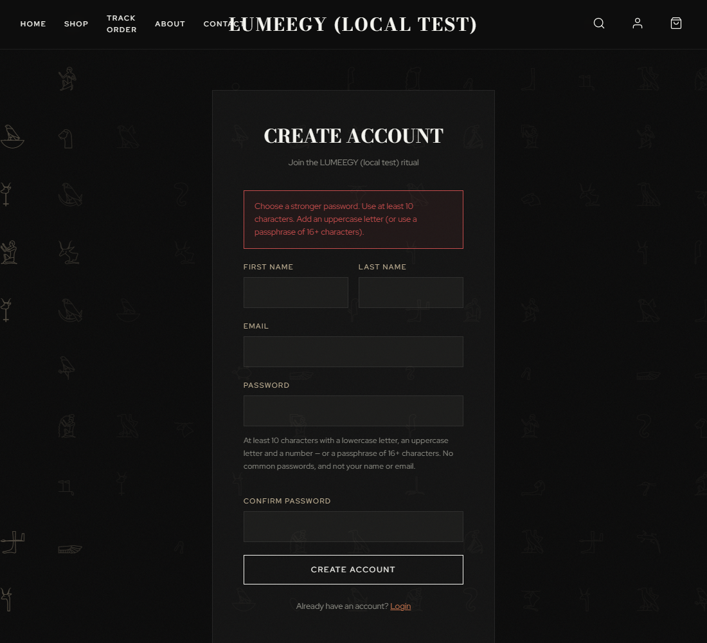<figcaption>After: the same password is rejected server-side (<code>screenshots/C2-weak-rejected.png</code>)</figcaption></figure>

**Fix.** **Control C2.** New `password_policy_errors($password, $email, $name)` (`includes/functions.php:337`) is called by registration (`account.php:82`) and password reset (`account.php:136`). Rules: 10–128 characters; lower + upper + digit **or** a passphrase of 16+ characters; not one repeated character; not in `includes/common-passwords.txt` (2,659 entries); must not contain the email, the email local part or the first name. Enforced on the server; the HTML `minlength` is only a convenience.

**Retest.** **AUTH-02 – pass.** Raw POSTs (no browser) with `password123`, `Short1`, password = email, password = name are all rejected with a reason; the passphrase `Blue-Kettle-Orbit-73` is accepted.

### CFG-02 – Session strict mode off (session fixation aid)

| | |
|---|---|
| **CVSS 3.1** | `CVSS:3.1/AV:N/AC:H/PR:N/UI:R/S:U/C:H/I:L/A:N` → **5.9 (Medium)** |
| **OWASP · CWE** | A07:2021 Identification and Authentication Failures · CWE-384 |
| **Source** | Config review |
| **Location** | `php.ini` (`session.use_strict_mode = 0`); code fix in `includes/functions.php:21-22` |
| **STRIDE** | T03 (session hijack / fixation) |
| **Status** | Fixed |

**Description.** With `session.use_strict_mode = 0` the server accepted a session ID it had never issued and kept using it. An attacker who can plant a known ID in a victim's browser (for example from a sibling sub-domain or an XSS) can then share the session after the victim logs in. The app already calls `session_regenerate_id` at login, which limits the risk; strict mode closes the remaining gap.

**Impact.** Possible takeover of a customer session. AC is High and UI is Required because the attacker first needs a way to set the cookie.

**Steps to reproduce.**

1. `curl -I -H "Cookie: lumeegy_session=attackerchosen1234567890abcdef" http://localhost:8090/`
2. Before: no `Set-Cookie` is returned, i.e. the server accepted the attacker-chosen ID.

**Evidence.** `evidence/H2-session-before.txt`; `evidence/H2-session-after.txt`; `evidence/tests/SESS-01.txt`; `evidence/tests/SESS-02.txt`.

**Fix.** **Hardening H2.** `lume_session_start()` sets `session.use_strict_mode=1` and `session.use_only_cookies=1` before `session_start()` (`includes/functions.php:21-22`). Sessions started under `/admin/` also get `SameSite=Strict` (`:37`); the storefront stays `Lax` so Google sign-in and the Paymob return still work.

**Retest.** **SESS-02 – pass** (a made-up ID is replaced; after logout the old cookie sees 0 order rows) and **SESS-01 – pass** (session ID rotates at login; `HttpOnly; SameSite=Lax`). `H2-session-after.txt`: made-up ID replaced = true, admin cookie `SameSite=Strict` = true.

### GAP-01 – No security event logging

| | |
|---|---|
| **CVSS 3.1** | `CVSS:3.1/AV:N/AC:H/PR:N/UI:N/S:U/C:L/I:L/A:N` → **4.8 (Medium)** |
| **OWASP · CWE** | A09:2021 Security Logging and Monitoring Failures · CWE-778 |
| **Source** | Code review |
| **Location** | Whole application (only an admin *Activity Log* and `error_log()` existed) |
| **STRIDE** | T11 (repudiation: attacks leave no trace); supports T01, T08, T19, T20 |
| **Status** | Fixed |

**Description.** Failed logins, CSRF rejections, denied access to admin pages and rejected uploads were not recorded anywhere. The Activity Log only listed what admins changed.

**Impact.** Brute-force, CSRF and access-control probing would go unnoticed and could not be investigated. This is a detection gap, not a direct exploit, so it is scored with Low confidentiality and integrity impact.

**Steps to reproduce.**

1. Make 5 wrong logins for a test account.
2. Open the admin Activity Log.
3. Nothing about the attempts is shown.

**Evidence.** `evidence/screenshots/before-C1-no-security-log.png` (before); `evidence/screenshots/C1-security-events.png` (after); `evidence/screenshots/C1-filter-xss.png`; `evidence/C1-verification.txt`; `evidence/burp/AUTH-01-c.png`.

<figure>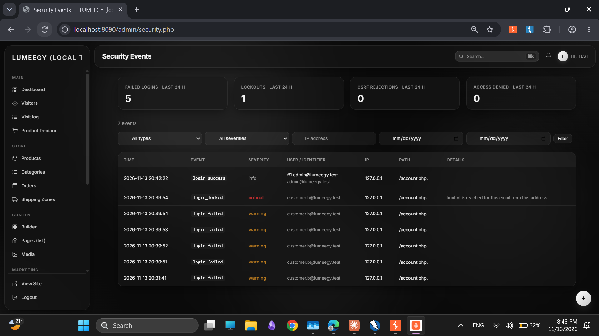<figcaption>Security Events after the brute-force run: 5 login_failed, 1 login_locked, then the admin login (<code>burp/AUTH-01-c.png</code>)</figcaption></figure>

**Fix.** **Control C1.** New table `security_events` and `security_log($type, $severity, $context)` in `includes/security-log.php` (never throws, truncates values, strips control characters, logs the path only and drops secret-looking keys). Events: `login_success`, `login_failed`, `login_locked`, `csrf_rejected` (inside `csrf_verify()`, `includes/functions.php:168`), `access_denied`, `password_reset_requested/_completed`, `upload_rejected`, `role_changed`, `logout`. New admin page `admin/security.php` with counters, filters and pagination.

**Retest.** Confirmed by the events the Part 2 tests produced: **AUTH-01** (5 × `login_failed` + 1 × `login_locked`), **CSRF-01** (4 × `csrf_rejected`), **RBAC-01** (5 × `access_denied`), **UPL-01** (3 × `upload_rejected`) – all pass.

### ZAP-01 – CSP allows unsafe-inline and wildcard sources; no frame-ancestors

| | |
|---|---|
| **CVSS 3.1** | `CVSS:3.1/AV:N/AC:H/PR:N/UI:R/S:C/C:L/I:L/A:N` → **4.7 (Medium)** |
| **OWASP · CWE** | A05:2021 Security Misconfiguration · CWE-693 |
| **Source** | DAST (ZAP) + config review |
| **Location** | `.htaccess:54` (baseline line; now `.htaccess:44-60`) |
| **STRIDE** | T09 (stored XSS), T16 (weak headers) |
| **Status** | Partly fixed; the rest is an accepted risk |

**Description.** ZAP raised four CSP alerts (CFG-04 and ZAP-01 are the same issue): `script-src` and `style-src` contain `'unsafe-inline'`, `img-src` and `media-src` allow any `https:` host, and `frame-ancestors` has no fallback to `default-src`, so it was not set. With `unsafe-inline` the CSP does not stop an injected inline script if an XSS bug exists.

**Impact.** Defence-in-depth only: no XSS was found (XSS-01, XSS-02), so the CSP weakness is not exploitable on its own. Scored with Scope Changed because a script that runs in the site's origin can reach other data.

**Steps to reproduce.**

1. `curl -I http://localhost:8090/` and read `Content-Security-Policy`.
2. ZAP report `evidence/zap/zap-before.html`, alerts "CSP: script-src unsafe-inline", "CSP: style-src unsafe-inline", "CSP: Wildcard Directive", "CSP: Failure to Define Directive with No Fallback".

**Evidence.** `evidence/zap/zap-before-summary.html`; `evidence/zap/zap-before.html`; `evidence/zap/zap-before-alerts.png`; `evidence/H1-headers-after.txt`.

**Fix.** **Hardening H1.** Added `frame-ancestors 'self'` (`.htaccess:54` area, header set with `Header always set`). `'unsafe-inline'` and the `https:` image/media sources are kept on purpose: removing them needs a nonce on every inline script and style in the theme, which is outside this project's scope (see section 7).

**Retest.** `H1-headers-after.txt`: the CSP now ends with `frame-ancestors 'self'` on 200, 404 and 403 responses. **XSS-01 / XSS-02 – pass**: output escaping (`h()`) is the primary XSS defence and it held. A ZAP rescan (`zap-after.html`) is **not available**, so the removal of the "no fallback" alert is shown by the header output, not by a second ZAP run.

### ZAP-03 – Third-party files loaded without Subresource Integrity

| | |
|---|---|
| **CVSS 3.1** | `CVSS:3.1/AV:N/AC:H/PR:N/UI:R/S:C/C:L/I:L/A:N` → **4.7 (Medium)** |
| **OWASP · CWE** | A08:2021 Software and Data Integrity Failures · CWE-829 / CWE-345 |
| **Source** | DAST (ZAP) |
| **Location** | `admin/includes/header.php:30` (Chart.js from jsDelivr); Google Fonts stylesheet on the storefront (`includes/header.php:104`, URL built by `google_fonts_url()` at `includes/functions.php:1837`) and on admin pages |
| **STRIDE** | T16, T09 |
| **Status** | Partly fixed (Chart.js); Google Fonts is an accepted risk |

**Description.** Chart.js was loaded from `cdn.jsdelivr.net` on every admin page with no `integrity` attribute. If the CDN or the file were tampered with, script would run in the admin panel. The Google Fonts stylesheet has the same exposure but is a CSS file only.

**Impact.** A compromised CDN file would run with admin privileges. AC is High because it needs a third-party compromise. Scope is Changed (script in the admin origin).

**Steps to reproduce.**

1. Open any admin page, view source, find the `<script src="https://cdn.jsdelivr.net/...chart...">` tag: no `integrity=` attribute.
2. ZAP: "Sub Resource Integrity Attribute Missing" and "Cross-Domain JavaScript Source File Inclusion".

**Evidence.** `evidence/zap/zap-before-summary.html`; `evidence/H1-chart-sri.txt`; `evidence/screenshots/H1-admin-chart-loads.png`.

<figure>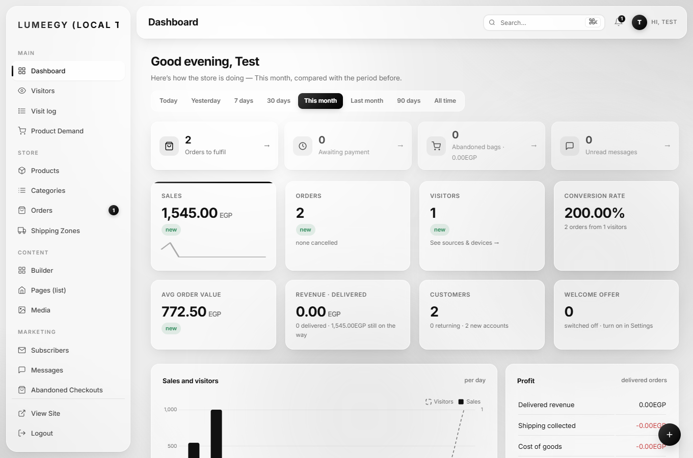<figcaption>Admin dashboard still renders the chart with SRI enabled (<code>screenshots/H1-admin-chart-loads.png</code>)</figcaption></figure>

**Fix.** **Hardening H1.** `admin/includes/header.php:30` now loads `chart.umd.js` (same Chart.js 4.4.1) with `integrity="sha256-…"` and `crossorigin="anonymous"`, using the hash published by jsDelivr. Google Fonts CSS differs per browser, so a fixed hash is not possible: accepted (self-hosting the fonts would remove it).

**Retest.** `H1-chart-sri.txt`: SRI attribute present = true, `window.Chart` is a function, the dashboard canvas renders, no integrity error in the console (the one 404 is the pre-existing `/favicon.ico`).

### ZAP-02 – Security headers missing on error pages and some responses

| | |
|---|---|
| **CVSS 3.1** | `CVSS:3.1/AV:N/AC:H/PR:N/UI:R/S:U/C:L/I:L/A:N` → **4.2 (Medium)** |
| **OWASP · CWE** | A05:2021 Security Misconfiguration · CWE-693 |
| **Source** | DAST (ZAP) |
| **Location** | `.htaccess` (every `Header set`; ZAP: "CSP Header Not Set", "Permissions Policy Header Not Set") |
| **STRIDE** | T16 (weak or missing headers) |
| **Status** | Fixed |

**Description.** `.htaccess` used `Header set`, which Apache applies only to successful (2xx/3xx) responses. Apache's own 403 and 404 pages, and some non-HTML responses, therefore had no CSP, `Permissions-Policy`, `X-Frame-Options` or `nosniff`.

**Impact.** Error pages are framable and carry no content policy. Low direct impact, hence the Medium rating comes from ZAP's classification and 5 affected URL patterns; the CVSS vector keeps it at the low end of Medium.

**Steps to reproduce.**

1. `curl -I http://localhost:8090/does-not-exist.php` and `curl -I http://localhost:8090/includes/`.
2. Before: no CSP and no security headers in the 404/403 responses.

**Evidence.** `evidence/screenshots/before-H1-headers.png` (before); `evidence/screenshots/H1-headers-after.png` (after); `evidence/H1-headers-after.txt`; `evidence/zap/zap-before-summary.html`.

<figure>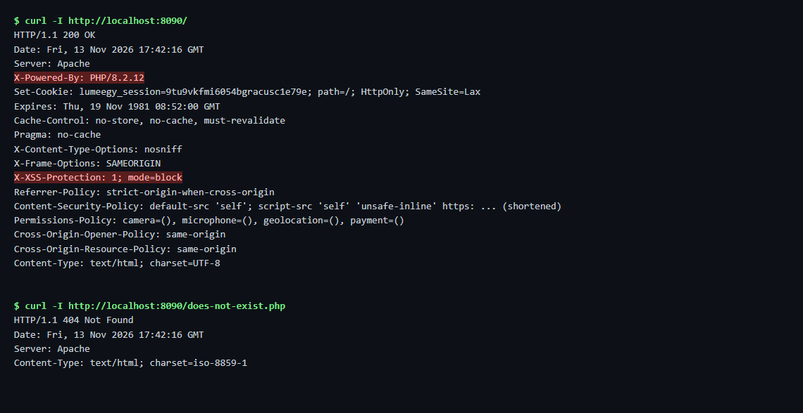<figcaption>Before: headers on a 404 response (<code>screenshots/before-H1-headers.png</code>)</figcaption></figure>

<figure>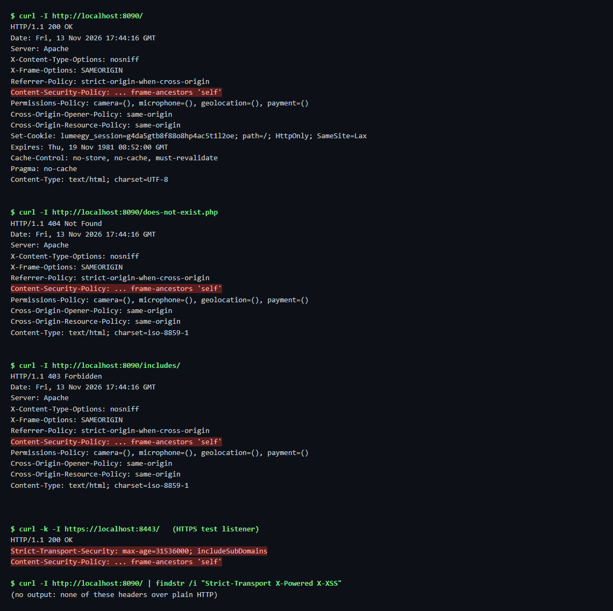<figcaption>After: headers present on 200, 404 and 403 (<code>screenshots/H1-headers-after.png</code>)</figcaption></figure>

**Fix.** **Hardening H1.** Every `Header set` in `.htaccess` is now `Header always set` (`.htaccess:44-60`). **Control C3** also adds branded `403.php`, `404.php`, `500.php` wired with `ErrorDocument` (`.htaccess:39-41`), so blocked folders show a clean page without a server banner.

**Retest.** `H1-headers-after.txt`: `/` (200), `/does-not-exist.php` (404) and `/includes/` (403) all carry `X-Content-Type-Options`, `X-Frame-Options`, `Referrer-Policy`, CSP, `Permissions-Policy`, COOP and CORP. `C3-verification-errpages.txt`: custom 404 and 403 with no `Apache/` or `PHP/` banner in the body.

### GAP-03 – Lockout message fixed, lockouts not logged, no admin unlock

| | |
|---|---|
| **CVSS 3.1** | `CVSS:3.1/AV:N/AC:H/PR:N/UI:N/S:U/C:N/I:N/A:L` → **3.7 (Low)** |
| **OWASP · CWE** | A07:2021 Identification and Authentication Failures · CWE-307 |
| **Source** | Code review |
| **Location** | `includes/functions.php` (`login_failed()`, throttle), `account.php`, `admin/login.php`, `admin/users.php` |
| **STRIDE** | T01 (brute force), T18 (lockout abused to lock real users out) |
| **Status** | Fixed |

**Description.** The login throttle existed, but always said "Please wait 15 minutes", never logged a lockout and gave admins no way to clear a lock for a customer.

**Impact.** A locked customer could not be helped by support, and the lockout could not be seen by anyone. Availability impact is Low (a single account, for at most 15 minutes).

**Steps to reproduce.**

1. Send 5 wrong passwords for `customer.b@lumeegy.test`, then a 6th.
2. The page says "Please wait 15 minutes" regardless of the time left; nothing is logged; the admin user page has no unlock option.

**Evidence.** `evidence/screenshots/before-C4-lockout-message.png` (before); `evidence/screenshots/C4-lockout-message.png`; `evidence/screenshots/C4-unlock-button.png`; `evidence/screenshots/C4-unlocked.png`; `evidence/C4-verification.txt`; `evidence/burp/AUTH-01.png`; `evidence/burp/AUTH-01-b.png`; `evidence/burp/AUTH-01-d.png`; `evidence/burp/AUTH-01-e.png`.

<figure>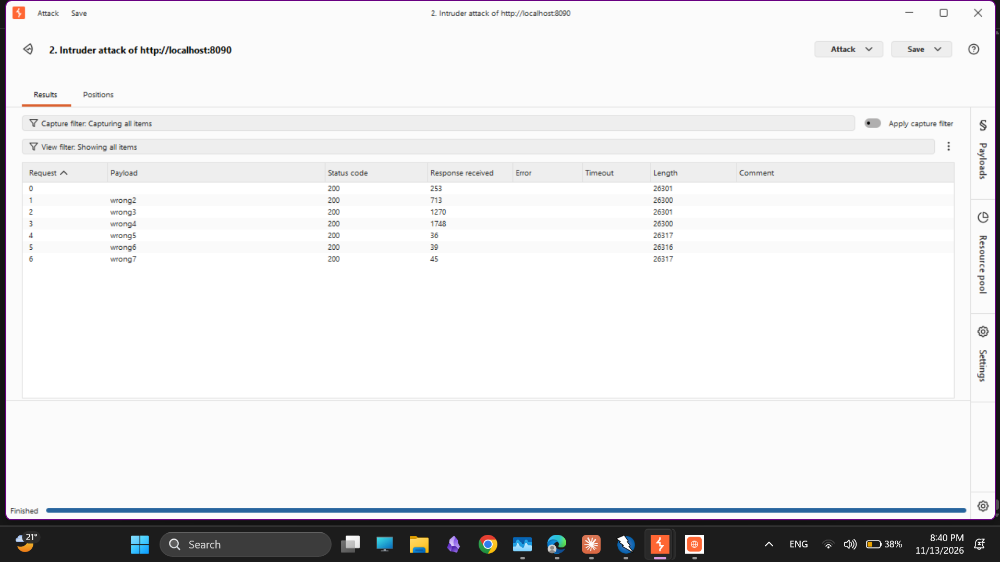<figcaption>Burp Intruder: 6 wrong passwords against account.php (login POST) (<code>burp/AUTH-01.png</code>)</figcaption></figure>

<figure>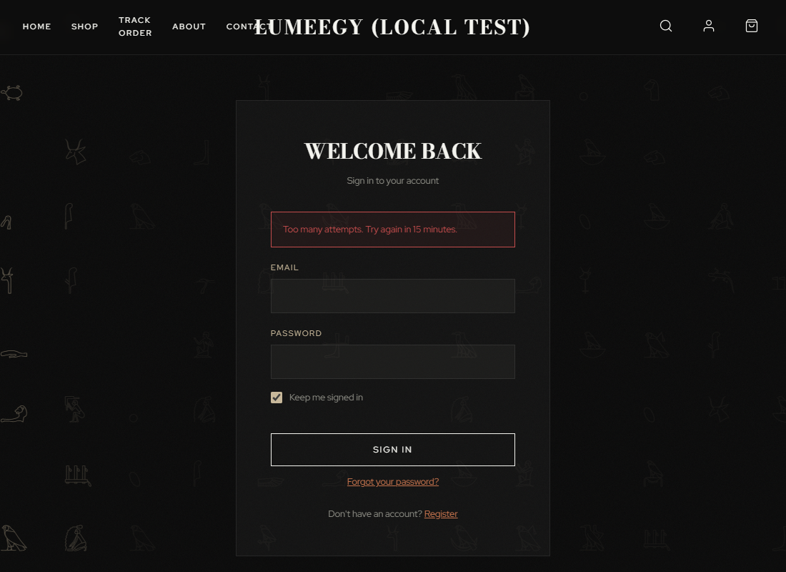<figcaption>The lockout message now shows the remaining time (<code>screenshots/C4-lockout-message.png</code>)</figcaption></figure>

**Fix.** **Control C4.** `login_lockout_remaining()` (`includes/functions.php:296`) and `login_lockout_message()` (`:313`) give "Too many attempts. Try again in N minutes." on both login pages (`account.php:51`, `admin/login.php:23`). `login_failed()` (`:328`) adds a progressive delay (0.5 s × (failures − 2), max 3 s) and logs `login_locked` once. `login_unlock()` (`:348`) and an **Unlock account** button (`admin/users.php:50`, `:171`) clear the counters and write `unlock_account` / `account_unlocked`. The tight email + address key means an attacker cannot lock the owner out from another address (T18). The optional "someone tried to sign in" email was not built (email is not configured in the test setup).

**Retest.** **AUTH-01 – pass.** Burp Intruder, 6 wrong passwords: the 6th answers "Too many attempts. Try again in 5 minutes."; 5 × `login_failed` + 1 × `login_locked` logged; admin **Unlock** lets the owner sign in again. The same account from another address signs in (HTTP 302), so the owner is not locked out by the attacker.

### ZAP-04 – Server and PHP version disclosure (X-Powered-By, Server)

| | |
|---|---|
| **CVSS 3.1** | `CVSS:3.1/AV:N/AC:H/PR:N/UI:N/S:U/C:L/I:N/A:N` → **3.7 (Low)** |
| **OWASP · CWE** | A05:2021 Security Misconfiguration · CWE-497 |
| **Source** | DAST (ZAP) + config review |
| **Location** | Apache / PHP configuration (`expose_php = On`); `.htaccess` (fix) |
| **STRIDE** | T16 |
| **Status** | Fixed (`X-Powered-By`); `Server` banner is a hosting setting |

**Description.** Responses carried `X-Powered-By: PHP/8.3.21` and `Server: Apache/2.4.63 (Win64) PHP/8.3.21` (CFG-01 and ZAP-04 are the same issue).

**Impact.** Tells an attacker exactly which versions to look up exploits for. It does not create a vulnerability by itself.

**Steps to reproduce.**

1. `curl -I http://localhost:8090/` and read the `Server` and `X-Powered-By` lines.

**Evidence.** `evidence/screenshots/before-H1-headers.png`; `evidence/screenshots/H1-headers-after.png`; `evidence/H1-headers-after.txt`; `evidence/zap/zap-before-summary.html`.

**Fix.** **Hardening H1.** `Header always unset X-Powered-By` (and the plain form) in `.htaccess`. The `Server:` banner is controlled by `ServerTokens Prod`, an Apache setting that cannot live in `.htaccess`; it is set in the local test configuration and must be set on the production host.

**Retest.** `H1-headers-after.txt`: no `X-Powered-By`; `Server: Apache` only (no version, no OS, no PHP).

### CFG-03 – HSTS header disabled

| | |
|---|---|
| **CVSS 3.1** | `CVSS:3.1/AV:N/AC:H/PR:N/UI:R/S:U/C:L/I:N/A:N` → **3.1 (Low)** |
| **OWASP · CWE** | A02:2021 Cryptographic Failures · CWE-319 |
| **Source** | Config review |
| **Location** | `.htaccess:52` (commented out at baseline) |
| **STRIDE** | T16 |
| **Status** | Fixed |

**Description.** `Strict-Transport-Security` was commented out, so a browser is never told to insist on HTTPS and a first request over HTTP can be downgraded.

**Impact.** Exposure to SSL-stripping on the first visit. Low on the local HTTP test copy; Medium on an HTTPS production site (see the note in findings.md).

**Steps to reproduce.**

1. `curl -I https://localhost:8443/` (self-signed local listener): no HSTS header.

**Evidence.** `evidence/H1-headers-after.txt`.

**Fix.** **Hardening H1.** `Header always set Strict-Transport-Security "max-age=31536000; includeSubDomains" "expr=%{HTTPS} == 'on'"` – sent only over HTTPS, so plain-HTTP local tests are unaffected.

**Retest.** `H1-headers-after.txt`: header present on `https://localhost:8443/`, 0 matching headers on `http://localhost:8090/`.

### ZAP-05 – Personal data in the URL query string

| | |
|---|---|
| **CVSS 3.1** | `CVSS:3.1/AV:N/AC:H/PR:N/UI:R/S:U/C:L/I:N/A:N` → **3.1 (Low)** |
| **OWASP · CWE** | A04:2021 Insecure Design · CWE-598 |
| **Source** | DAST (ZAP) |
| **Location** | `contact.php:47` (form has no `method`), `track-order.php:75` (`method="get"`) |
| **STRIDE** | T12 / T16 (information disclosure) |
| **Status** | Not fixed (recommendation; outside the Part 1 scope) |

**Description.** `track-order.php` sends the email and order number as a GET query string. The contact form has no `method`, so without JavaScript the browser sends name, email and message as `GET contact.php?email=…`. Query strings end up in browser history, server logs and `Referer` headers.

**Impact.** Leaks personal data to logs and third parties. Low: only the user's own data, and the contact form normally submits through `api/contact.php` with JavaScript.

**Steps to reproduce.**

1. Open `track-order.php`, submit an email and order number, and look at the address bar: `?email=…&order=…`.
2. ZAP: "Information Disclosure – Sensitive Information in URL" (2 instances).

**Evidence.** `evidence/zap/zap-before-summary.html`; `evidence/zap/zap-before.html`.

**Fix.** No code change was made. Recommended: `method="post"` on the contact form, and POST (with CSRF token) for track-order.

**Retest.** Not retested because it was not changed. The source confirms the state: `contact.php:47` has no `method`, `track-order.php:75` is still `method="get"`.

### ZAP-06 – Cross-Origin-Embedder-Policy header missing

| | |
|---|---|
| **CVSS 3.1** | `CVSS:3.1/AV:N/AC:H/PR:N/UI:R/S:U/C:L/I:N/A:N` → **3.1 (Low)** |
| **OWASP · CWE** | A05:2021 Security Misconfiguration · CWE-693 |
| **Source** | DAST (ZAP) |
| **Location** | `.htaccess` (response headers) |
| **STRIDE** | T16 |
| **Status** | Accepted risk |

**Description.** ZAP reports that responses carry no `Cross-Origin-Embedder-Policy`. COEP, with COOP, isolates the page from cross-origin resources (needed mainly for `SharedArrayBuffer`-type features).

**Impact.** Low: it reduces side-channel exposure only; the site already sends COOP and CORP.

**Steps to reproduce.**

1. `curl -I http://localhost:8090/`: no COEP header.

**Evidence.** `evidence/zap/zap-before-summary.html`; `evidence/H1-headers-after.txt`.

**Fix.** None, by decision. `Cross-Origin-Embedder-Policy: require-corp` would block the Paymob payment iframe and YouTube/Vimeo embeds, which the shop needs. Documented as an accepted risk in section 7.

**Retest.** Not applicable (accepted).

### SAST-01 – Raw database exception text shown on admin screens

| | |
|---|---|
| **CVSS 3.1** | `CVSS:3.1/AV:N/AC:H/PR:H/UI:N/S:U/C:L/I:N/A:N` → **2.2 (Low)** |
| **OWASP · CWE** | A04:2021 Insecure Design · CWE-209 |
| **Source** | SAST (Semgrep) |
| **Location** | `admin/pages.php:35`, `admin/settings.php:96`, `admin/shipping.php:28`, `admin/themes.php:19` and `:74`, `admin/variants.php:102` |
| **STRIDE** | T13 (error pages reveal SQL, paths, stack traces) |
| **Status** | Fixed |

**Description.** Rule `lumeegy-exception-message-to-user` found six places that print `$e->getMessage()`, i.e. the raw PDO error (SQLSTATE, table and column names), on an admin screen. Admin-only, hence Low.

**Impact.** Reveals schema details to a signed-in admin (or to an attacker who has an admin session).

**Steps to reproduce.**

1. In the admin Shipping Zones page, add a zone with the same name as an existing zone.
2. Before: the page shows the SQLSTATE duplicate-key text.

**Evidence.** `evidence/screenshots/before-C3-raw-error.png` (before); `evidence/screenshots/C3-admin-error-with-ref.png` (after); `evidence/C3-verification-s1.txt`; `evidence/semgrep/semgrep-before.txt`; `evidence/semgrep/semgrep-after.txt`.

<figure>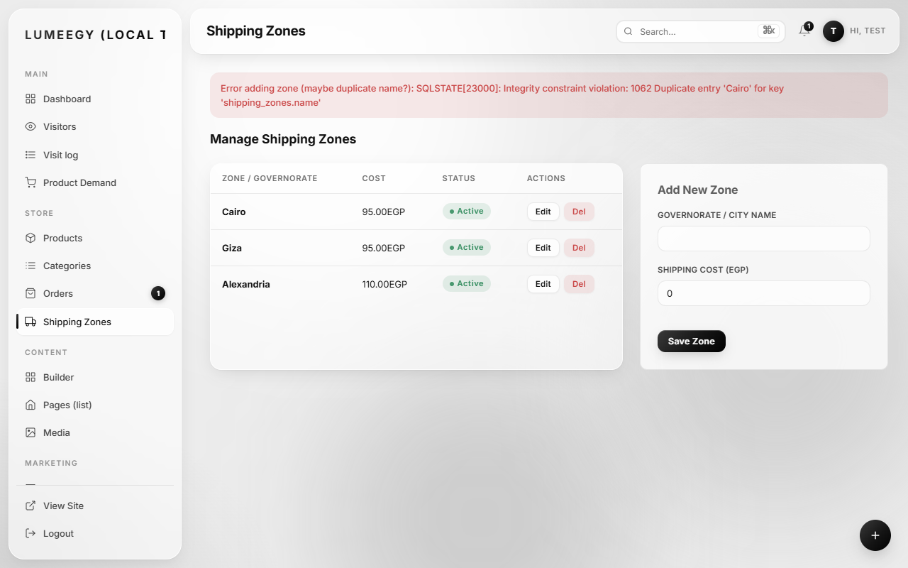<figcaption>Before: raw SQL error on an admin screen (<code>screenshots/before-C3-raw-error.png</code>)</figcaption></figure>

<figure>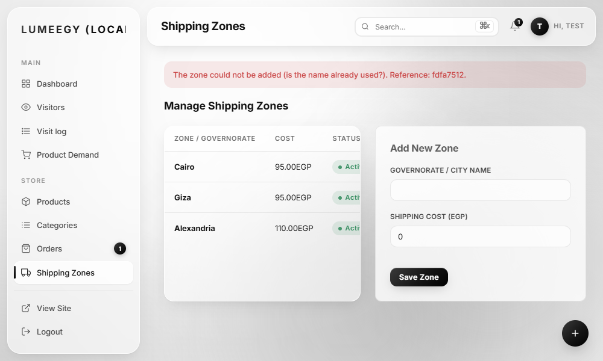<figcaption>After: generic message with a reference ID (<code>screenshots/C3-admin-error-with-ref.png</code>)</figcaption></figure>

**Fix.** **Control C3 / fix S1.** New `lume_error_message($e, $what)` (`includes/error-handler.php:88`) logs the detail with a reference ID and returns "<what failed>. Reference: <id>." The six places call it. C3 also adds a global exception, error and shutdown handler (`includes/error-handler.php`, first file loaded by `config/config.php:11`) and a generic 500 page; `config/database.php:33` calls `lume_fail()` instead of `die()` with the PDO text.

**Retest.** **Semgrep after:** the six locations no longer match (`lumeegy-exception-message-to-user` 14 → 7; the 7 left are in other files, see N1/N2 in section 7). `C3-verification-s1.txt`: the message shows only a reference ID; the log holds the PDO error for that ID.

### SAST-02 – Order status changed outside set_order_status()

| | |
|---|---|
| **CVSS 3.1** | `CVSS:3.1/AV:N/AC:H/PR:H/UI:N/S:U/C:N/I:L/A:N` → **2.2 (Low)** |
| **OWASP · CWE** | A04:2021 Insecure Design · CWE-841 |
| **Source** | SAST (Semgrep) |
| **Location** | `admin/order-new.php:86`, `checkout.php:260` |
| **STRIDE** | T07 / T08 (order and stock integrity) |
| **Status** | Fixed |

**Description.** Two places ran a bare `UPDATE orders SET status`, bypassing `set_order_status()`, which locks the order row, applies the stock rules and writes `updated_at`. With the statuses used today stock is not corrupted, but a future status change at these places could be.

**Impact.** Latent integrity risk (stock and audit trail). Not exploitable today.

**Steps to reproduce.**

1. Run Semgrep with `semgrep-lumeegy.yml`: rule `lumeegy-direct-order-status-update` reports both lines.

**Evidence.** `evidence/semgrep/semgrep-before.txt`; `evidence/semgrep/semgrep-after.txt`; `evidence/smoke-hardening.txt`; `semgrep-triage.md`.

**Fix.** **Fix S2.** Both places now call `set_order_status()`.

**Retest.** **Semgrep after:** rule hits 5 → 3; the 3 left are `set_order_status()` / `cancel_order()` themselves (`includes/functions.php:1175/1204/1273`), the intended false positives. `smoke-hardening.txt`: a manual order created as `paid` ends `paid` and takes 1 from stock; an InstaPay checkout ends `pending_payment`.

### CFG-05 – Deprecated X-XSS-Protection header sent

| | |
|---|---|
| **CVSS 3.1** | `CVSS:3.1/AV:N/AC:H/PR:N/UI:R/S:U/C:N/I:N/A:N` → **0.0 (Informational)** |
| **OWASP · CWE** | A05:2021 Security Misconfiguration · CWE-693 |
| **Source** | Config review |
| **Location** | `.htaccess:48` |
| **STRIDE** | T16 |
| **Status** | Fixed |

**Description.** `X-XSS-Protection: 1; mode=block` is deprecated; in old browsers its filter could itself be abused. Modern browsers ignore it.

**Impact.** Informational (score 0.0): no practical exploit in current browsers.

**Steps to reproduce.**

1. `curl -I http://localhost:8090/` (baseline): the header is present.

**Evidence.** `evidence/screenshots/before-H1-headers.png`; `evidence/H1-headers-after.txt`.

**Fix.** **Hardening H1.** The header was removed from `.htaccess`; the CSP is the XSS defence.

**Retest.** `H1-headers-after.txt`: no `X-XSS-Protection` on any response.

### SAST-03 – db()->quote() used instead of a placeholder

| | |
|---|---|
| **CVSS 3.1** | `CVSS:3.1/AV:N/AC:H/PR:H/UI:N/S:U/C:N/I:N/A:N` → **0.0 (Informational)** |
| **OWASP · CWE** | A03:2021 Injection · CWE-89 (hardening) |
| **Source** | SAST (Semgrep) |
| **Location** | `admin/abandoned.php:46` |
| **STRIDE** | T06 (SQL injection) – consistency only |
| **Status** | Fixed |

**Description.** The status filter was built with `db()->quote()`. It is safe, but it breaks the project rule "always prepared statements" and would be easy to copy wrongly.

**Impact.** None today (score 0.0, informational): the value was quoted correctly.

**Steps to reproduce.**

1. Semgrep rule `quote-instead-of-placeholder` reports `admin/abandoned.php:46`.

**Evidence.** `evidence/semgrep/semgrep-before.txt`; `evidence/semgrep/semgrep-after.txt`; `evidence/smoke-hardening.txt`.

**Fix.** **Fix S3.** The filter now uses a `?` placeholder with `execute()`.

**Retest.** **Semgrep after:** 1 → 0. `smoke-hardening.txt`: all five valid filters and the injection attempt `show=x' OR '1'='1` return HTTP 200 (the attempt falls back to `open`).

## 6. Final results (before → after)

### 6.1 Part 2 manual tests – 16 / 16 pass, 0 findings

| Category | Tests | Result |
|---|---|---|
| SQL injection | SQLI-01 (Repeater/curl), SQLI-02 (sqlmap) | pass, pass |
| XSS | XSS-01 (reflected), XSS-02 (stored, shown escaped to admin) | pass, pass |
| Authentication | AUTH-01 (Intruder, lockout), AUTH-02 (password policy) | pass, pass |
| Authorization | RBAC-01 (admin pages and APIs), RBAC-02 (IDOR) | pass, pass |
| Session management | SESS-01 (cookie flags, ID rotation), SESS-02 (fixation) | pass, pass |
| Input validation | INP-01 (quantity), INP-02 (price, zone, variant tampering) | pass, pass |
| CSRF | CSRF-01 (admin and API), CSRF-02 (cross-origin from `localhost:9000`) | pass, pass |
| File upload | UPL-01 (`shell.php`, `shell.php.jpg`, PHP-in-JPEG), UPL-02 (random name, no script execution) | pass, pass |

Every test also ran a positive control (the same action works for the right user). Details, payloads and evidence files per test: `test-cases.md`, `test-cases.xlsx`, `evidence/tests/`, `evidence/burp/`, `evidence/sqlmap/`.

<figure>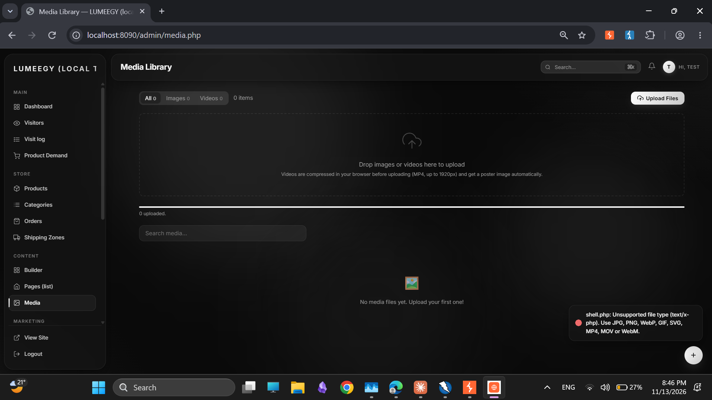<figcaption>UPL-01: Burp-driven upload of <code>shell.php</code> is rejected (<code>evidence/burp/UPL-01.png</code>)</figcaption></figure>

<figure>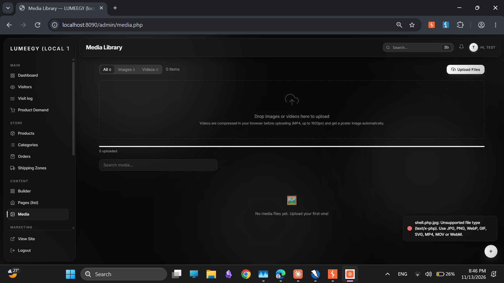<figcaption>UPL-01: <code>shell.php.jpg</code> is rejected on its detected type (<code>evidence/burp/UPL-01-shelljpg.png</code>)</figcaption></figure>

### 6.2 Semgrep – before and after

Same command and rulesets (`semgrep-before.*` vs `semgrep-after.*`). Raw totals **201 → 199**: almost all results are triaged false positives (output escaped with `h()`, prepared statements, whitelisted `ORDER BY`) whose line numbers move when code is added, so the raw count is not a measure of progress. What matters is that **all three static true positives are closed** (`semgrep-triage.md`):

| Baseline finding | Rule | Before | After | Status |
|---|---|---|---|---|
| SAST-01 raw exception text (6 admin screens) | `lumeegy-exception-message-to-user` | 6 of these | 0 of these | Fixed (C3 / S1) |
| SAST-02 order status outside `set_order_status()` | `lumeegy-direct-order-status-update` | 5 | 3 | Fixed (S2); the 3 left are the canonical functions themselves |
| SAST-03 `db()->quote()` | `quote-instead-of-placeholder` | 1 | 0 | Fixed (S3) |

One rule rose from 0 to 2 – `lumeegy-upload-without-mime-check` on `admin/settings.php` and `admin/variants.php` – and is a **false positive**: both call the shared `upload_check_image()` (H3, `finfo` at `includes/functions.php:1484`); the rule only recognises an inline `finfo`. **Net: 0 High before and after; no new real issue.**

### 6.3 ZAP – baseline

Baseline (before fixes), localhost only: **0 High · 7 Medium · 6 Low · 16 Informational** alert types, from a Spider (575 URLs), AJAX Spider and an Active Scan stopped at 23%.

| ZAP alert (risk) | Disposition |
|---|---|
| Absence of Anti-CSRF Tokens (Medium, 3) | False positive: the admin token is added at runtime from `<meta name="csrf-token">`; 1,131 scanner POSTs without it were rejected with 403 |
| CSP: no fallback / wildcard / `script-src` and `style-src` `unsafe-inline` (Medium, 4 alert types) | ZAP-01: `frame-ancestors` added (H1); `unsafe-inline` and `https:` sources accepted |
| CSP Header Not Set (Medium) · Permissions Policy Header Not Set (Low) | ZAP-02: fixed (H1) |
| Sub Resource Integrity Missing (Medium) · Cross-Domain JS Inclusion (Low) | ZAP-03: Chart.js fixed (H1); Google Fonts accepted |
| `X-Powered-By` and `Server` leaks (Low, 2) | ZAP-04: fixed (H1); `Server` banner is a hosting setting |
| COEP missing (Low) | ZAP-06: accepted |
| Timestamp Disclosure – Unix (Low) | False positive: cache-busting `?v=` values |
| Sensitive Information in URL (Informational, 2) | ZAP-05: recommendation, not fixed |
| User Controllable HTML Element Attribute (83), Suspicious Comments (97) and 12 other informational types | False positive / no action (see appendix) |

**ZAP after.** A second ZAP scan after the fixes (`zap-after.html`) is **not in the evidence folder** and is not claimed here. The closure of ZAP-02, ZAP-03, ZAP-04, CFG-03 and CFG-05 is evidenced by the direct header checks in `evidence/H1-headers-after.txt` and `evidence/H1-chart-sri.txt`.

### 6.4 Findings status

| Status | Count | Findings |
|---|---|---|

| Fixed | 11 | GAP-02, CFG-02, GAP-01, ZAP-02, GAP-03, ZAP-04, CFG-03, SAST-01, SAST-02, CFG-05, SAST-03 |
| Partly fixed (rest accepted) | 2 | ZAP-01, ZAP-03 |
| Accepted risk | 1 | ZAP-06 |
| Not fixed (recommended) | 1 | ZAP-05 |

## 7. Residual risks and recommendations

### 7.1 Accepted risks

| Risk | Why it is accepted | Recommendation for production |
|---|---|---|
| CSP `'unsafe-inline'` for scripts and styles, and `https:` for images and media (ZAP-01) | Removing it needs a nonce on every inline script and style in the theme and builder; no XSS was found (XSS-01/02) and `h()` escaping is the primary defence. | Add per-request nonces, move inline code to files, then drop `unsafe-inline`; list product-media hosts instead of `https:`. |
| Google Fonts stylesheet without SRI (ZAP-03) | The CSS changes per browser, so a fixed hash cannot be used. Chart.js, the script, does have SRI. | Self-host the fonts and remove the external stylesheet. |
| No `Cross-Origin-Embedder-Policy` (ZAP-06) | `require-corp` would break the Paymob iframe and YouTube/Vimeo embeds. | Revisit if payments and video move to same-origin or CORP-enabled sources. |
| `Server:` banner (ZAP-04) | An Apache setting, not `.htaccess`; it is set to `Prod` in the local test configuration only. | Set `ServerTokens Prod` and `ServerSignature Off` on the host; keep `expose_php = Off`. |
| HSTS only over HTTPS (CFG-03) | By design: it must not be sent on plain HTTP. | Confirm `SITE_URL` is `https://…` on production and that the header appears there; consider `preload` once stable. |

### 7.2 Open recommendation

- **ZAP-05.** Add `method="post"` to the contact form (`contact.php:47`) and move `track-order.php:75` to POST with a CSRF token, so personal data stays out of URLs and logs.

### 7.3 Smaller observations from Part 1 (not scored; logged in `implementation.md`)

| # | Location | Observation |
|---|---|---|
| N1 | `api/admin-products.php:349`, `:425` | JSON error returns `$e->getMessage()` to the admin browser (Low). Same fix as S1. |
| N2 | `api/section-preview.php:90` | Shows an escaped exception message in an admin-only preview (Info). |
| N3 | `includes/auth.php` | Unused second copy of the admin guard with a wrong `require_once` path; remove it. |
| N4 | `login_succeeded()` | A successful login clears the email-wide counter for all addresses; the tight email + address counter is unaffected. |
| N5 | `account.php` registration and reset | bcrypt uses only the first 72 bytes; cap the password at 72 bytes or pre-hash. |
| N6 | `account.php` | After a rejected registration the form comes back empty; keep name and email. |

### 7.4 General recommendations

1. Keep C1 logging and review `admin/security.php` regularly; alert on `login_locked` and `csrf_rejected` spikes.
2. Run Semgrep (`semgrep-lumeegy.yml`) and a ZAP rescan in CI or before each release.
3. Finish the optional "someone tried to sign in" email in C4 once email sending is configured.
4. Before launch, repeat the header checks against the real HTTPS host.

## 8. Appendix

### A. Raw tool output

| What | File |
|---|---|
| ZAP raw report (baseline) | `evidence/zap/zap-before.html` |
| ZAP summary with our verdict per alert | `evidence/zap/zap-before-summary.html` |
| ZAP alerts screenshot, AJAX Spider requests | `evidence/zap/zap-before-alerts.png`, `evidence/zap/ajax-spider-before.csv` |
| Semgrep before / after | `evidence/semgrep/semgrep-before.txt`, `.sarif`, `.json` · `semgrep-after.txt`, `.sarif`, `.json` |
| Semgrep triage | `semgrep-triage.md` |
| sqlmap | `evidence/sqlmap/SQLI-02.txt` |
| Burp screenshots, CSRF proof of concept | `evidence/burp/` (`AUTH-01*.png`, `UPL-01*.png`, `csrf-poc.html`) |
| Scripted test output | `evidence/tests/*.txt` |
| Part 1 before / after | `evidence/screenshots/`, `evidence/C*-verification*.txt`, `evidence/H*-*.txt`, `evidence/smoke-*.txt` |

### B. False-positive log

| Alert / result | Count | Reason |
|---|---|---|
| ZAP "Absence of Anti-CSRF Tokens" | 3 alert types | The flagged forms are admin forms; their token is added at runtime by `admin/includes/csrf-script.php` from `<meta name="csrf-token">`, which ZAP's HTML parser cannot see. **Proof the protection works:** every scanner POST to an admin form without the token was rejected with **403** (1,131 times in the access log). The same result is reproduced by **CSRF-01** (missing/wrong token → 403 and `csrf_rejected` logged) and **CSRF-02** (forged cross-origin POST → 400 "Invalid CSRF token"). |
| ZAP "Timestamp Disclosure – Unix" | 5 | Cache-busting asset versions (`?v=1791899996`), not server times. |
| ZAP "User Controllable HTML Element Attribute (Potential XSS)" | 83 | Request values echoed into attributes, escaped with `h()`; confirmed by XSS-01. |
| ZAP "Information Disclosure – Suspicious Comments" | 97 | Words like "TODO" or "admin" in comments; no secrets found. |
| Semgrep results | 192 of 201 | Output already escaped with `h()`, integer IDs, SQL whose structure uses placeholders and whitelists, documented CSRF exceptions (HMAC webhook, analytics beacons), `thumb.php` path checks. See `semgrep-triage.md`. |
| Semgrep `lumeegy-upload-without-mime-check` (after run) | 2 | The shared `upload_check_image()` performs the `finfo` check. |

### C. Items without a ZAP retest

No `zap-after.html` exists. Findings that the ZAP baseline raised are therefore closed by direct evidence (`H1-headers-after.txt`, `H1-chart-sri.txt`, `H2-session-after.txt`) and by the Part 2 tests, not by a second ZAP scan.
