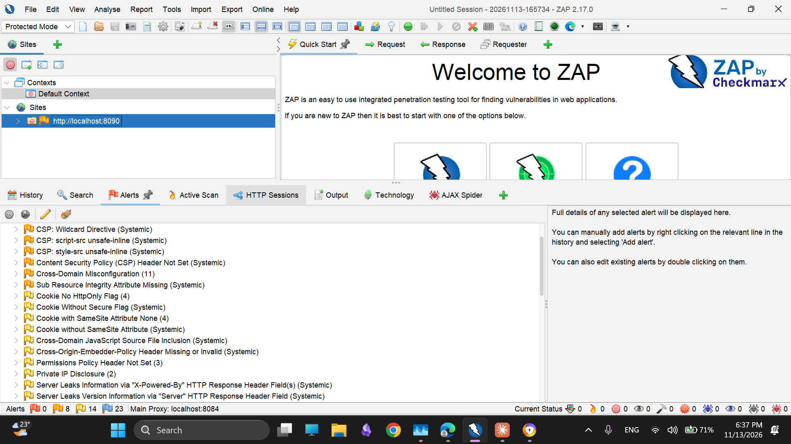

Security in Software Engineering · Part 4

# Vulnerability Assessment Report {.tp-title}

LUMEEGY: PHP / MySQL e-commerce storefront

| | |
|---|---|
| **Supervisors** | Dr. Manar Hafaz · Eng. Nada Amr Shaheen |
| **Target** | Local test copy only: `http://localhost:8090` (seeded test database, fake accounts) |
| **Assessment date** | 13 November 2026 |
| **Report version** | 1.1, 14 November 2026 |
| **Method** | SAST (Semgrep + code review) → DAST (OWASP ZAP) → manual (Burp Suite, sqlmap) · OWASP WSTG · CVSS 3.1 |

The live site was never scanned, probed or touched. Every test ran on an authorized local copy.

## Contents {.no-num}

<!-- TOC -->

## 1 Executive summary {#s1}

We assessed LUMEEGY, a plain PHP 8.1+ / MySQL storefront with an admin panel, **on a local copy only**. We used three layers of testing: static analysis (Semgrep and manual code review), an authenticated dynamic scan (OWASP ZAP), and manual attacks (Burp Suite Community and sqlmap). Tests follow the OWASP WSTG, findings are mapped to the OWASP Top 10 (2021) and CWE, and severity is scored with CVSS 3.1.

15

real findings at baseline 0 High 6 Med 7 Low 2 Info

11 / 15

fully fixed 2 partly fixed · 1 accepted · 1 open (recommendation)

0 High

left after fixes remaining: 2 Med (residual, accepted) 2 Low

16 / 16

manual security tests pass 2 per category × 8 categories, 0 new findings

3 → 0

static (Semgrep) true-positive findings raw results 201 → 199, all remaining triaged

0 · 7 · 6 · 16

ZAP baseline alert types High · Medium · Low · Info (all triaged)

**What we found.** No High or Critical issue. The Medium findings were a weak password policy, PHP's session strict mode being off, no security event logging, and weak or missing security headers (CSP, SRI, headers on error pages). The Low findings were mostly information leaks (version banners, raw database errors on admin screens) and hardening gaps.

**What we fixed.** Part 1 added four controls (**C1** security event logging, **C2** password policy, **C3** secure error handling, **C4** account lockout), three hardening items (**H1** headers, **H2** sessions, **H3** uploads) and three static-analysis fixes (**S1–S3**).

**What is left.** Part of the CSP (`'unsafe-inline'`), SRI for the Google Fonts stylesheet and COEP are accepted risks with reasons (section 7). Personal data in the URL (ZAP-05) is an open recommendation.

**Limits.** The ZAP active scan was stopped at 23%, so SQL injection and XSS were tested manually instead (SQLI-01/02, XSS-01/02). No ZAP rescan was run after the fixes. The header fixes are shown with direct `curl` output instead.

| Brief item (Part 4) | Where in this report |
|---|---|
| Identified vulnerabilities | §4 Findings summary, §5 Finding details |
| Vulnerability severity | §4 (CVSS 3.1 score + band), each card in §5 (vector) |
| Testing methodology | §2 Scope, §3 Methodology |
| Evidence (screenshots) | §5 (figures + evidence files per finding), Appendix A |
| Implemented security fixes | §5 "Fix" in each card (file + function), §6.4 |
| Final testing results | §6 (16/16 tests, Semgrep before → after, ZAP baseline and disposition), §7 residual risk |

## 2 Scope and environment {#s2}

**Target.** A local copy only: Apache 2.4 on `http://localhost:8090`, MySQL 8.0, database `lumeegy_test` loaded from `database/schema.sql` and `database/seed-security-test.sql`. A second self-signed TLS listener on `https://localhost:8443` was used only to check HSTS. **The live site was not scanned, probed or touched in any way.**

**Test accounts (fake, local only).** guest (no login) · customer A `customer.a@lumeegy.test` · customer B `customer.b@lumeegy.test` · admin `admin@lumeegy.test`. Each customer has one order, so ownership (IDOR) can be tested.

**Excluded from active testing.** The Paymob webhook (`api/paymob_callback.php`), the payment and Google callbacks, logout, destructive `action=delete` URLs, `admin/users.php` (during the ZAP scan) and the analytics beacons. ZAP ran in Protected Mode, so out-of-scope hosts were blocked. All 18 delete attempts during the scan were refused (403), and the seed data was unchanged afterwards.

| Tool | Version | Layer | Used for |
|---|---|---|---|
| Semgrep (`p/php`, `p/owasp-top-ten`, `p/xss` + 12 custom rules) | 1.185 | SAST | Source scan before and after Part 1 |
| OWASP ZAP (Spider, AJAX Spider, Active Scan, passive) | 2.17 | DAST | Authenticated baseline scan |
| Burp Suite Community (Proxy, Repeater, Intruder) | 2026.10.1 | Manual | Brute force, upload tampering, request replay |
| sqlmap | 1.10.11 | Manual | SQL injection probing (SQLI-02) |
| curl | 8.14 | Manual | Scripted, repeatable request tests |

## 3 Methodology {#s3}

<b>1 · SAST</b> Semgrep + manual code review <small>41 rules, 89 files, 201 raw results, each triaged</small>

→

<b>2 · DAST</b> OWASP ZAP, logged in as admin <small>Spider 575 URLs, AJAX Spider 1,510 requests, Active Scan</small>

→

<b>3 · Manual</b> Burp Suite, sqlmap, curl <small>16 test cases, 2 per category, each with a positive control</small>

→

<b>4 · Fix + retest</b> Part 1 controls, then rerun <small>Semgrep after-run, header checks, 16 tests</small>

1. **SAST.** Semgrep ran before Part 1 and again after. Every result was marked true positive, false positive or parse gap, with the reason written down (`semgrep-triage.md`). Manual code review covered what a pattern tool cannot judge: login and lockout logic, password rules, order ownership, logging.
2. **DAST.** ZAP crawled the running site (Spider and AJAX Spider) and ran an Active Scan with the default policy, logged in as the test admin. Passive checks covered every crawled page.
3. **Manual.** The attacks a scanner cannot judge: IDOR, role bypass, brute force and lockout, cross-origin CSRF, upload tricks and business-logic tampering. Each of the 16 tests has a **positive control**: the same action works for the right user. A blocked result therefore proves the defence worked, not that the page was broken.

**Standards.** Tests carry OWASP WSTG IDs. Findings are mapped to the OWASP Top 10 (2021) and a CWE. This mapping is ours, so it can differ from the tags ZAP prints. Threats come from a STRIDE model (T01–T21, `threat-model.md`).

**Severity scale (CVSS 3.1 base score).** Critical 9.0–10.0 High 7.0–8.9 Medium 4.0–6.9 Low 0.1–3.9 Info 0.0

**Limits.** The ZAP active scan was stopped at **23% (47,820 requests)** for time. Burp Community has no scanner and a rate-limited Intruder. Because of this, **SQL injection and XSS were verified manually** (SQLI-01/02, XSS-01/02) and not left to the scanner.

## 4 Findings summary {#s4}

15 real findings, ordered by CVSS score. Duplicates are merged (CFG-04 = ZAP-01, CFG-01 = ZAP-04). Locations are the **baseline** lines. Status: **Fixed** · **Partly fixed** (the remainder is an accepted risk, §7) · **Accepted** · **Open** (recommendation only). The CVSS scores agree with the provisional severities in `findings.md`; no band changed.

| ID | Title | Source | CVSS | Severity | OWASP · CWE | Status |
|---|---|---|---|---|---|---|
| GAP-02 | Weak password policy | Code review | 6.5 | Medium | A07 · CWE-521 | Fixed |
| CFG-02 | Session strict mode off (fixation aid) | Config review | 5.9 | Medium | A07 · CWE-384 | Fixed |
| GAP-01 | No security event logging | Code review | 4.8 | Medium | A09 · CWE-778 | Fixed |
| ZAP-01 | CSP allows unsafe-inline / wildcards; no frame-ancestors | ZAP + config | 4.7 | Medium | A05 · CWE-693 | Partly fixed |
| ZAP-03 | Third-party files without Subresource Integrity | ZAP | 4.7 | Medium | A08 · CWE-829 | Partly fixed |
| ZAP-02 | Security headers missing on error pages | ZAP | 4.2 | Medium | A05 · CWE-693 | Fixed |
| GAP-03 | Lockout not logged, fixed message, no admin unlock | Code review | 3.7 | Low | A07 · CWE-307 | Fixed |
| ZAP-04 | Server and PHP version disclosure | ZAP + config | 3.7 | Low | A05 · CWE-497 | Fixed |
| CFG-03 | HSTS header disabled | Config review | 3.1 | Low | A02 · CWE-319 | Fixed |
| ZAP-05 | Personal data in the URL query string | ZAP | 3.1 | Low | A04 · CWE-598 | Open |
| ZAP-06 | Cross-Origin-Embedder-Policy missing | ZAP | 3.1 | Low | A05 · CWE-693 | Accepted |
| SAST-01 | Raw database errors on admin screens | Semgrep | 2.2 | Low | A04 · CWE-209 | Fixed |
| SAST-02 | Order status changed outside set_order_status() | Semgrep | 2.2 | Low | A04 · CWE-841 | Fixed |
| CFG-05 | Deprecated X-XSS-Protection header | Config review | 0.0 | Info | A05 · CWE-693 | Fixed |
| SAST-03 | db()->quote() instead of a placeholder | Semgrep | 0.0 | Info | A03 · CWE-89 | Fixed |

| Severity | Baseline | Open or accepted after fixes |
|---|---|---|
| Critical | 0 | 0 |
| High | 0 | 0 |
| Medium | 6 | 2 (residual of ZAP-01, ZAP-03) |
| Low | 7 | 2 (ZAP-05, ZAP-06) |
| Info | 2 | 0 |
| **Total** | **15** | **4** |

<!-- CHART:severity -->

## 5 Findings in detail {#s5}

Every card has the same layout: header (ID, title, severity) → description → impact → steps to reproduce → CVSS vector → evidence → fix → retest. Files under `evidence/` are in `docs/security/evidence/` of the repository. Line numbers in **Fix** refer to the current `main`.

### GAP-02 – Weak password policy Medium 6.5 {#gap-02}

Code review · A07:2021 Identification and Authentication Failures · CWE-521 · STRIDE T02 · Fixed · baseline <code>account.php:81</code>, <code>:131</code>

**Description.** Registration and password reset accepted any password of 8 or more characters (`password1` was accepted). The only check was one `strlen()` call: no complexity, common-password or personal-data rules.

**Impact.** A guessed or sprayed password gives full access to a customer account (order history, addresses, phone numbers). AC is High because the login throttle still limits the guessing rate.

**Steps to reproduce (baseline).**

1. Open `http://localhost:8090/account.php?action=register`.
2. Register with the password `password1` (or send the POST with curl, which skips browser checks). The account is created.

**CVSS 3.1.** `CVSS:3.1/AV:N/AC:H/PR:N/UI:N/S:U/C:H/I:L/A:N` → **6.5 Medium**

**Evidence.** `screenshots/before-C2-weak-password.png`, `screenshots/C2-weak-rejected.png`, `screenshots/C2-strong-accepted.png`, `C2-verification.txt`, `tests/AUTH-02.txt`.

<figure><figcaption>Figure 1. Before: <code>password1</code> is accepted.</figcaption></figure>
<figure><figcaption>Figure 2. After: the same password is rejected on the server.</figcaption></figure>

**Fix (C2).** `password_policy_errors($password, $email, $name)` (`includes/functions.php:430`) is called by registration (`account.php:86`) and password reset (`account.php:140`). Rules: 10–128 characters; lower + upper + digit, **or** a passphrase of 16+ characters; not one repeated character; not in `includes/common-passwords.txt` (2,659 entries); must not contain the email, its local part or the first name. Enforced on the server; the HTML `minlength` is only a hint.

**Retest. AUTH-02: pass.** Raw POSTs with `password123`, `Short1`, password = email and password = name are all rejected with a reason. The passphrase `Blue-Kettle-Orbit-73` is accepted.

### CFG-02 – Session strict mode off (session fixation aid) Medium 5.9 {#cfg-02}

Config review · A07:2021 · CWE-384 · STRIDE T03 · Fixed · <code>php.ini</code> (<code>session.use_strict_mode = 0</code>)

**Description.** With strict mode off, the server accepted a session ID it had never issued and kept using it. An attacker who can plant a known ID in a victim's browser can share the session after the victim logs in. The app already regenerated the ID at login, which limits the risk; strict mode closes the remaining gap.

**Impact.** Possible takeover of a customer session. AC is High and UI Required, because the attacker first needs a way to set the cookie.

**Steps to reproduce (baseline).**

1. `curl -I -H "Cookie: lumeegy_session=attackerchosen1234567890abcdef" http://localhost:8090/`
2. No new `Set-Cookie` comes back: the attacker-chosen ID was accepted.

**CVSS 3.1.** `CVSS:3.1/AV:N/AC:H/PR:N/UI:R/S:U/C:H/I:L/A:N` → **5.9 Medium**

**Evidence.** `H2-session-before.txt`, `H2-session-after.txt`, `tests/SESS-01.txt`, `tests/SESS-02.txt`.

**Fix (H2).** `lume_session_start()` sets `session.use_strict_mode=1` and `session.use_only_cookies=1` before `session_start()` (`includes/functions.php:21-22`). Sessions under `/admin/` also get `SameSite=Strict` (`:37`). The storefront stays `Lax`, so Google sign-in and the Paymob return still work.

**Retest. SESS-02: pass** (a made-up ID is replaced; after logout the old cookie sees 0 order rows). **SESS-01: pass** (the ID rotates at login; `HttpOnly; SameSite=Lax`). `H2-session-after.txt`: made-up ID replaced = true; admin cookie `SameSite=Strict` = true.

### GAP-01 – No security event logging Medium 4.8 {#gap-01}

Code review · A09:2021 Security Logging and Monitoring Failures · CWE-778 · STRIDE T11 · Fixed · whole application

**Description.** Failed logins, CSRF rejections, denied admin access and rejected uploads were not recorded anywhere. The existing Activity Log only listed what admins changed.

**Impact.** Brute force, CSRF and access-control probing would go unnoticed and could not be investigated. This is a detection gap, not a direct exploit, so confidentiality and integrity impact are Low.

**Steps to reproduce (baseline).**

1. Make 5 wrong logins for a test account.
2. Open the admin Activity Log: nothing about the attempts is shown.

**CVSS 3.1.** `CVSS:3.1/AV:N/AC:H/PR:N/UI:N/S:U/C:L/I:L/A:N` → **4.8 Medium**

**Evidence.** `screenshots/before-C1-no-security-log.png`, `screenshots/C1-security-events.png`, `screenshots/C1-filter-xss.png`, `C1-verification.txt`, `burp/AUTH-01-c.png`.

<figure class="wide"><figcaption>Figure 3. After: the new Security Events page after the Burp brute-force run, showing 5 <code>login_failed</code>, 1 <code>login_locked</code>, then the admin login.</figcaption></figure>

**Fix (C1).** New table `security_events` and `security_log($type, $severity, $context)` in `includes/security-log.php`. It never throws, truncates values, strips control characters, logs the path only and drops secret-looking keys. Events: `login_success`, `login_failed`, `login_locked`, `csrf_rejected` (inside `csrf_verify()`, `includes/functions.php:178`), `access_denied`, `password_reset_requested/_completed`, `upload_rejected`, `role_changed`, `account_unlocked`, `logout`. New admin page `admin/security.php` with 24-hour counters, filters and pagination.

**Retest. Pass**, shown by the events the Part 2 tests produced: AUTH-01 (5 × `login_failed` + 1 × `login_locked`), CSRF-01 (4 × `csrf_rejected`), RBAC-01 (5 × `access_denied`), UPL-01 (3 × `upload_rejected`).

### ZAP-01 – CSP allows unsafe-inline and wildcards; no frame-ancestors Medium 4.7 {#zap-01}

ZAP + config review · A05:2021 Security Misconfiguration · CWE-693 · STRIDE T09, T16 · Partly fixed · baseline <code>.htaccess:54</code>

**Description.** ZAP raised four CSP alerts (CFG-04 is the same issue). `script-src` and `style-src` contain `'unsafe-inline'`; `img-src` and `media-src` allow any `https:` host; and `frame-ancestors` was not set (it has no fallback to `default-src`). With `unsafe-inline`, the CSP would not stop an injected inline script if an XSS bug existed.

**Impact.** Defence in depth only: no XSS was found (XSS-01, XSS-02), so this is not exploitable on its own. Scope is Changed because script running in the site's origin can reach other data.

**Steps to reproduce (baseline).**

1. `curl -I http://localhost:8090/` and read `Content-Security-Policy`.
2. ZAP alerts "CSP: script-src unsafe-inline", "CSP: style-src unsafe-inline", "CSP: Wildcard Directive", "CSP: Failure to Define Directive with No Fallback".

**CVSS 3.1.** `CVSS:3.1/AV:N/AC:H/PR:N/UI:R/S:C/C:L/I:L/A:N` → **4.7 Medium**

**Evidence.** `zap/zap-before.html`, `zap/zap-before-summary.html`, `zap/zap-before-alerts.png`, `H1-headers-after.txt`.

<figure class="wide"><figcaption>Figure 4. ZAP baseline alert tree for <code>http://localhost:8090</code> (the CSP, SRI and header alerts behind ZAP-01 to ZAP-06).</figcaption></figure>

**Fix (H1).** `frame-ancestors 'self'` added to the CSP, sent with `Header always set` (`.htaccess:60`). `'unsafe-inline'` and the `https:` image and media sources stay on purpose: removing them needs a nonce on every inline script and style in the theme, which is outside this project's scope (§7).

**Retest. Partly fixed.** `H1-headers-after.txt`: the CSP ends with `frame-ancestors 'self'` on 200, 404 and 403 responses. XSS-01 and XSS-02 pass: output escaping with `h()` is the primary XSS defence and it held. No ZAP rescan was run, so the closed "no fallback" alert is shown by the header output.

### ZAP-03 – Third-party files loaded without Subresource Integrity Medium 4.7 {#zap-03}

ZAP · A08:2021 Software and Data Integrity Failures · CWE-829 / CWE-345 · STRIDE T09, T16 · Partly fixed · <code>admin/includes/header.php:30</code>; Google Fonts in <code>includes/header.php:104</code>

**Description.** Chart.js was loaded from `cdn.jsdelivr.net` on every admin page with no `integrity` attribute. If the CDN copy were tampered with, script would run in the admin panel. The Google Fonts stylesheet (URL built by `google_fonts_url()`, `includes/functions.php:1820`) has the same exposure but is CSS only.

**Impact.** A compromised CDN file would run with admin privileges. AC is High because it needs a third-party compromise; Scope is Changed.

**Steps to reproduce (baseline).**

1. Open any admin page and view the source: the Chart.js `<script>` tag has no `integrity=`.
2. ZAP: "Sub Resource Integrity Attribute Missing", "Cross-Domain JavaScript Source File Inclusion".

**CVSS 3.1.** `CVSS:3.1/AV:N/AC:H/PR:N/UI:R/S:C/C:L/I:L/A:N` → **4.7 Medium**

**Evidence.** `zap/zap-before-summary.html`, `H1-chart-sri.txt`, `screenshots/H1-admin-chart-loads.png`.

**Fix (H1).** `admin/includes/header.php:30` loads `chart.umd.js` (same Chart.js 4.4.1) with `integrity="sha256-…"` and `crossorigin="anonymous"`, using the hash jsDelivr publishes. The Google Fonts CSS differs per browser, so a fixed hash is impossible: accepted (self-hosting the fonts would remove it).

**Retest. Partly fixed.** `H1-chart-sri.txt`: SRI attribute present = true, `window.Chart` is a function, the dashboard chart renders, no integrity error in the console.

### ZAP-02 – Security headers missing on error pages Medium 4.2 {#zap-02}

ZAP · A05:2021 · CWE-693 · STRIDE T16 · Fixed · <code>.htaccess</code> (every <code>Header set</code>)

**Description.** `.htaccess` used `Header set`, which Apache applies only to successful responses. Apache's own 403 and 404 pages, and some non-HTML responses, had no CSP, `Permissions-Policy`, `X-Frame-Options` or `nosniff`. ZAP: "CSP Header Not Set", "Permissions Policy Header Not Set".

**Impact.** Error pages could be framed and carried no content policy. The direct impact is small, so the vector sits at the low end of Medium.

**Steps to reproduce (baseline).**

1. `curl -I http://localhost:8090/does-not-exist.php` and `curl -I http://localhost:8090/includes/`.
2. The 404 and 403 responses have no CSP and no security headers.

**CVSS 3.1.** `CVSS:3.1/AV:N/AC:H/PR:N/UI:R/S:U/C:L/I:L/A:N` → **4.2 Medium**

**Evidence.** `screenshots/before-H1-headers.png`, `screenshots/H1-headers-after.png`, `H1-headers-after.txt`, `C3-verification-errpages.txt`.

<figure><figcaption>Figure 5. Before: response headers at baseline, with the version banners (ZAP-04) and <code>X-XSS-Protection</code> (CFG-05).</figcaption></figure>
<figure><figcaption>Figure 6. After: the security headers on 200, 404 and 403 responses.</figcaption></figure>

**Fix (H1 + C3).** Every `Header set` is now `Header always set` (`.htaccess:49-65`). C3 adds branded `403.php`, `404.php` and `500.php`, wired with `ErrorDocument` (`.htaccess:39-41`).

**Retest. Pass.** `H1-headers-after.txt`: `/` (200), `/does-not-exist.php` (404) and `/includes/` (403) all carry `X-Content-Type-Options`, `X-Frame-Options`, `Referrer-Policy`, CSP, `Permissions-Policy`, COOP and CORP. `C3-verification-errpages.txt`: custom 404 and 403 pages, with no `Apache/` or `PHP/` banner in the body.

### GAP-03 – Lockout not logged, fixed message, no admin unlock Low 3.7 {#gap-03}

Code review · A07:2021 · CWE-307 · STRIDE T01, T18 · Fixed · <code>includes/functions.php</code> (throttle), <code>account.php</code>, <code>admin/login.php</code>, <code>admin/users.php</code>

**Description.** A login throttle existed, but it always said "Please wait 15 minutes", never logged a lockout, and gave admins no way to clear a lock.

**Impact.** A locked customer could not be helped by support, and nobody could see that a lockout happened. Availability impact is Low (one account, at most 15 minutes).

**Steps to reproduce (baseline).**

1. Send 5 wrong passwords for `customer.b@lumeegy.test`, then a 6th.
2. The page says "Please wait 15 minutes" whatever the time left; nothing is logged; the admin user page has no unlock option.

**CVSS 3.1.** `CVSS:3.1/AV:N/AC:H/PR:N/UI:N/S:U/C:N/I:N/A:L` → **3.7 Low**

**Evidence.** `screenshots/before-C4-lockout-message.png`, `screenshots/C4-lockout-message.png`, `screenshots/C4-unlock-button.png`, `screenshots/C4-unlocked.png`, `C4-verification.txt`, `burp/AUTH-01.png`, `burp/AUTH-01-b.png`, `-d.png`, `-e.png`.

<figure><figcaption>Figure 7. Burp Intruder against the login POST. Response times grow (progressive delay), then drop once the account is locked.</figcaption></figure>
<figure><figcaption>Figure 8. After: the lockout message shows the time left.</figcaption></figure>

**Fix (C4).** `login_lockout_remaining()` (`includes/functions.php:306`) and `login_lockout_message()` (`:323`) show "Too many attempts. Try again in N minutes." on both login pages (`account.php:51`, `admin/login.php:23`). `login_failed()` (`:338`) adds a progressive delay (0.5 s × (failures − 2), max 3 s) and logs `login_locked` once. `login_unlock()` (`:358`) and an **Unlock account** button (`admin/users.php:50`, `:171`) clear the counters and log `account_unlocked`. The tight email + address key means an attacker cannot lock the owner out from another address (T18).

**Retest. AUTH-01: pass.** After 6 wrong passwords: "Too many attempts. Try again in 5 minutes."; 5 × `login_failed` + 1 × `login_locked` logged; admin **Unlock** lets the owner sign in again. The same account signs in from another address (HTTP 302).

### ZAP-04 – Server and PHP version disclosure Low 3.7 {#zap-04}

ZAP + config review · A05:2021 · CWE-497 · STRIDE T16 · Fixed (X-Powered-By; <code>Server</code> is a hosting setting) · Apache / PHP configuration

**Description.** Responses carried `X-Powered-By: PHP/8.3.21` and `Server: Apache/2.4.63 (Win64) PHP/8.3.21` (CFG-01 is the same issue).

**Impact.** Tells an attacker exactly which versions to look up exploits for. It is not a vulnerability by itself.

**Steps to reproduce (baseline).** `curl -I http://localhost:8090/` and read `Server` and `X-Powered-By` (Figure 5).

**CVSS 3.1.** `CVSS:3.1/AV:N/AC:H/PR:N/UI:N/S:U/C:L/I:N/A:N` → **3.7 Low**

**Evidence.** `screenshots/before-H1-headers.png` (Figure 5), `screenshots/H1-headers-after.png` (Figure 6), `H1-headers-after.txt`.

**Fix (H1).** `Header always unset X-Powered-By` in `.htaccess:57`. The `Server` banner is set by `ServerTokens Prod`, an Apache setting that cannot go in `.htaccess`. It is set in the local test configuration and must be set on the production host.

**Retest. Pass.** `H1-headers-after.txt`: no `X-Powered-By`; `Server: Apache` only (no version, OS or PHP).

### CFG-03 – HSTS header disabled Low 3.1 {#cfg-03}

Config review · A02:2021 Cryptographic Failures · CWE-319 · STRIDE T16 · Fixed · baseline <code>.htaccess:52</code> (commented out)

**Description.** `Strict-Transport-Security` was commented out, so browsers were never told to insist on HTTPS, and a first visit over HTTP could be downgraded.

**Impact.** SSL stripping on the first visit. Low on the local HTTP copy; Medium on an HTTPS production site.

**Steps to reproduce (baseline).** `curl -I https://localhost:8443/` (self-signed local listener): no HSTS header.

**CVSS 3.1.** `CVSS:3.1/AV:N/AC:H/PR:N/UI:R/S:U/C:L/I:N/A:N` → **3.1 Low**

**Evidence.** `H1-headers-after.txt`.

**Fix (H1).** `Header always set Strict-Transport-Security "max-age=31536000; includeSubDomains" "expr=%{HTTPS} == 'on'"` (`.htaccess:55`). It is sent only over HTTPS.

**Retest. Pass.** `H1-headers-after.txt`: header present on `https://localhost:8443/`, absent on `http://localhost:8090/`.

### ZAP-05 – Personal data in the URL query string Low 3.1 {#zap-05}

ZAP · A04:2021 Insecure Design · CWE-598 · STRIDE T12 · Open (recommendation) · <code>track-order.php:75</code>, <code>contact.php:47</code>

**Description.** `track-order.php` sends the email and order number as a GET query string. The contact form has no `method`, so without JavaScript the browser sends name, email and message as `GET contact.php?email=…`. Query strings end up in browser history, server logs and `Referer` headers.

**Impact.** Personal data leaks to logs. Low: it is the user's own data, and the contact form normally submits through `api/contact.php` with JavaScript.

**Steps to reproduce.** Submit the track-order form and look at the address bar: `?email=…&order=…`. ZAP: "Information Disclosure – Sensitive Information in URL" (2 instances).

**CVSS 3.1.** `CVSS:3.1/AV:N/AC:H/PR:N/UI:R/S:U/C:L/I:N/A:N` → **3.1 Low**

**Evidence.** `zap/zap-before.html`, `zap/zap-before-summary.html`.

**Fix.** None yet (outside the Part 1 scope). Recommended: `method="post"` on the contact form, and POST with a CSRF token for track-order.

**Retest.** Not retested, because nothing changed. The current source confirms it: `contact.php:47` still has no `method`; `track-order.php:75` is still `method="get"`.

### ZAP-06 – Cross-Origin-Embedder-Policy header missing Low 3.1 {#zap-06}

ZAP · A05:2021 · CWE-693 · STRIDE T16 · Accepted · <code>.htaccess</code>

**Description.** Responses have no `Cross-Origin-Embedder-Policy`. Together with COOP, COEP isolates a page from cross-origin resources.

**Impact.** Low: it only reduces side-channel exposure, and the site already sends COOP and CORP.

**Steps to reproduce.** `curl -I http://localhost:8090/`: no COEP header.

**CVSS 3.1.** `CVSS:3.1/AV:N/AC:H/PR:N/UI:R/S:U/C:L/I:N/A:N` → **3.1 Low**

**Evidence.** `zap/zap-before-summary.html`, `H1-headers-after.txt`.

**Fix.** None, by decision: `require-corp` would block the Paymob payment iframe and YouTube/Vimeo embeds that the shop needs (§7).

**Retest.** Not applicable (accepted risk).

### SAST-01 – Raw database errors on admin screens Low 2.2 {#sast-01}

Semgrep · A04:2021 · CWE-209 · STRIDE T13 · Fixed · baseline <code>admin/pages.php:35</code>, <code>settings.php:96</code>, <code>shipping.php:28</code>, <code>themes.php:19</code> and <code>:74</code>, <code>variants.php:102</code>

**Description.** Rule `lumeegy-exception-message-to-user` found six places that print `$e->getMessage()` (the raw PDO error with SQLSTATE, table and column names) on an admin screen. Admin only, hence Low.

**Impact.** Shows schema details to anyone holding an admin session.

**Steps to reproduce (baseline).** In admin → Shipping Zones, add a zone with the same name as an existing one: the page shows the SQLSTATE duplicate-key text.

**CVSS 3.1.** `CVSS:3.1/AV:N/AC:H/PR:H/UI:N/S:U/C:L/I:N/A:N` → **2.2 Low**

**Evidence.** `screenshots/before-C3-raw-error.png`, `screenshots/C3-admin-error-with-ref.png`, `C3-verification-s1.txt`, `semgrep/semgrep-before.txt`, `semgrep/semgrep-after.txt`.

<figure><figcaption>Figure 9. Before: raw SQL error on an admin screen.</figcaption></figure>
<figure><figcaption>Figure 10. After: a generic message with a reference ID.</figcaption></figure>

**Fix (C3 / S1).** `lume_error_message($e, $what)` (`includes/error-handler.php:88`) logs the detail with a reference ID and returns "&lt;what failed&gt;. Reference: &lt;id&gt;.". The six places call it. C3 also adds global exception, error and shutdown handlers (`includes/error-handler.php`, loaded first by `config/config.php:11`) and a generic 500 page. `config/database.php:33` calls `lume_fail()` instead of printing the PDO text.

**Retest. Pass.** Semgrep after-run: none of the six locations match (rule hits 14 → 7; the 7 left are in `api/admin-products.php` and `api/section-preview.php`, noted as N1/N2 in §7.3). `C3-verification-s1.txt`: the screen shows only a reference ID, and the log holds the PDO error for that ID.

### SAST-02 – Order status changed outside set_order_status() Low 2.2 {#sast-02}

Semgrep · A04:2021 · CWE-841 · STRIDE T07, T08 · Fixed · baseline <code>admin/order-new.php:86</code>, <code>checkout.php:260</code>

**Description.** Two places ran a bare `UPDATE orders SET status`, bypassing `set_order_status()`, which locks the order row, applies the stock rules and writes `updated_at`. With today's statuses stock is not corrupted, but a future change at these places could corrupt it.

**Impact.** Latent integrity risk (stock and audit trail). Not exploitable today.

**Steps to reproduce (baseline).** Run Semgrep with `semgrep-lumeegy.yml`: rule `lumeegy-direct-order-status-update` reports both lines.

**CVSS 3.1.** `CVSS:3.1/AV:N/AC:H/PR:H/UI:N/S:U/C:N/I:L/A:N` → **2.2 Low**

**Evidence.** `semgrep/semgrep-before.txt`, `semgrep/semgrep-after.txt`, `smoke-hardening.txt`.

**Fix (S2).** Both places now call `set_order_status()`.

**Retest. Pass.** Semgrep after-run: rule hits 5 → 3; the 3 left are inside `set_order_status()` / `cancel_order()` themselves (`includes/functions.php:1175`, `:1204`, `:1273`). `smoke-hardening.txt`: a manual order created as `paid` ends `paid` and takes 1 from stock.

### CFG-05 – Deprecated X-XSS-Protection header Info 0.0 {#cfg-05}

Config review · A05:2021 · CWE-693 · STRIDE T16 · Fixed · baseline <code>.htaccess:48</code>

**Description.** `X-XSS-Protection: 1; mode=block` is deprecated; in old browsers the filter could itself be abused. Modern browsers ignore it.

**Impact.** None in current browsers. **Steps to reproduce (baseline).** `curl -I http://localhost:8090/`: the header is present (Figure 5).

**CVSS 3.1.** `CVSS:3.1/AV:N/AC:H/PR:N/UI:R/S:U/C:N/I:N/A:N` → **0.0 Info**

**Evidence.** `screenshots/before-H1-headers.png`, `H1-headers-after.txt`. **Fix (H1).** Header removed; the CSP is the XSS defence. **Retest. Pass.** `H1-headers-after.txt`: no `X-XSS-Protection` on any response.

### SAST-03 – db()->quote() instead of a placeholder Info 0.0 {#sast-03}

Semgrep · A03:2021 Injection · CWE-89 (hardening only) · STRIDE T06 · Fixed · baseline <code>admin/abandoned.php:46</code>

**Description.** The status filter was built with `db()->quote()`. That is safe, but it breaks the project rule "always prepared statements" and is easy to copy wrongly.

**Impact.** None today: the value was quoted correctly. **Steps to reproduce (baseline).** Semgrep rule `quote-instead-of-placeholder` reports `admin/abandoned.php:46`.

**CVSS 3.1.** `CVSS:3.1/AV:N/AC:H/PR:H/UI:N/S:U/C:N/I:N/A:N` → **0.0 Info**

**Evidence.** `semgrep/semgrep-before.txt`, `semgrep/semgrep-after.txt`, `smoke-hardening.txt`. **Fix (S3).** The filter uses a `?` placeholder with `execute()`. **Retest. Pass.** Semgrep 1 → 0. `smoke-hardening.txt`: all five valid filters and the injection attempt `show=x' OR '1'='1` return HTTP 200 (the attempt falls back to `open`).

## 6 Final results (before → after) {#s6}

### 6.1 Part 2 manual tests: 16 / 16 pass, 0 new findings {#s61}

| Category | Test 1 | Test 2 | Result |
|---|---|---|---|
| SQL injection | SQLI-01 search, filter, sort (Repeater / curl) | SQLI-02 sqlmap on `q`, `slug` | 2 / 2 |
| XSS | XSS-01 reflected | XSS-02 stored, contact form → admin messages | 2 / 2 |
| Authentication | AUTH-01 Intruder brute force → lockout | AUTH-02 password policy (raw POST) | 2 / 2 |
| Authorization / RBAC | RBAC-01 admin pages and APIs as guest / customer | RBAC-02 IDOR on another customer's order | 2 / 2 |
| Session management | SESS-01 cookie flags, ID rotation | SESS-02 fixation, old cookie after logout | 2 / 2 |
| Input validation | INP-01 quantity tampering | INP-02 price, zone, variant tampering | 2 / 2 |
| CSRF | CSRF-01 missing / wrong token (admin, API) | CSRF-02 forged cross-origin POST | 2 / 2 |
| File upload | UPL-01 `shell.php`, `shell.php.jpg`, PHP in JPEG | UPL-02 random name, no execution in `assets/` | 2 / 2 |

Every test also ran a positive control. Payloads, expected and actual results, and evidence per test are in `test-cases.md` / `test-cases.xlsx`.

<figure><figcaption>Figure 11. UPL-01: upload of <code>shell.php</code> through Burp is rejected.</figcaption></figure>
<figure><figcaption>Figure 12. UPL-01: <code>shell.php.jpg</code> is rejected on its detected type.</figcaption></figure>

### 6.2 Semgrep: before → after {#s62}

Same command and rulesets for both runs. Raw totals go **201 → 199**. Nearly all raw results are triaged false positives (output already escaped with `h()`, prepared statements, a whitelisted `ORDER BY`), and their line numbers move when code is added, so the raw count does not measure progress. What matters is that **all three static true-positive findings are closed**:

| Finding | Rule | Before | After | Result |
|---|---|---|---|---|
| SAST-01 raw exception text | `lumeegy-exception-message-to-user` | 6 of these | 0 of these | Fixed (C3 / S1) |
| SAST-02 status outside `set_order_status()` | `lumeegy-direct-order-status-update` | 5 | 3 (the function itself) | Fixed (S2) |
| SAST-03 `db()->quote()` | `quote-instead-of-placeholder` | 1 | 0 | Fixed (S3) |
| (new) upload without inline MIME check | `lumeegy-upload-without-mime-check` | 0 | 2 | False positive: both call the shared `upload_check_image()` (H3, `finfo` at `includes/functions.php:1484`) |

### 6.3 OWASP ZAP: baseline and disposition {#s63}

Baseline, localhost only: **0 High · 7 Medium · 6 Low · 16 Informational** alert types, from the Spider (575 URLs), the AJAX Spider and an Active Scan stopped at 23%.

| Risk | Alert types | Real finding (fixed / partly / accepted / open) | False positive or no action |
|---|---|---|---|
| High | 0 | – | – |
| Medium | 7 | 6: CSP ×4 → ZAP-01; CSP not set → ZAP-02; SRI → ZAP-03 | 1: Anti-CSRF tokens (token added at runtime) |
| Low | 6 | 5: Permissions-Policy → ZAP-02; cross-domain JS → ZAP-03; `X-Powered-By`, `Server` → ZAP-04; COEP → ZAP-06 | 1: Unix timestamps (cache-busting `?v=`) |
| Info | 16 | 1: sensitive data in URL → ZAP-05 | 15 (Appendix B) |

**No ZAP rescan.** A second ZAP scan after the fixes was not run, so there is no `zap-after.html` and none is claimed. The closure of ZAP-02, ZAP-03 (Chart.js), ZAP-04, CFG-03 and CFG-05 is shown by direct checks: `H1-headers-after.txt` and `H1-chart-sri.txt`. The full per-alert table is in Appendix C.

### 6.4 Findings status {#s64}

| Status | Count | Findings |
|---|---|---|
| Fixed | 11 | GAP-02, CFG-02, GAP-01, ZAP-02, GAP-03, ZAP-04, CFG-03, SAST-01, SAST-02, CFG-05, SAST-03 |
| Partly fixed (rest accepted) | 2 | ZAP-01, ZAP-03 |
| Accepted | 1 | ZAP-06 |
| Open (recommendation) | 1 | ZAP-05 |

## 7 Residual risks and recommendations {#s7}

### 7.1 Accepted risks {#s71}

| Risk | Why it is accepted | Recommendation for production |
|---|---|---|
| CSP `'unsafe-inline'` for scripts and styles; `https:` for images and media (ZAP-01) | Removing it needs a nonce on every inline script and style in the theme and page builder. No XSS was found, and `h()` escaping is the primary defence. | Add per-request nonces, move inline code to files, then drop `unsafe-inline`; list the media hosts instead of `https:`. |
| Google Fonts stylesheet without SRI (ZAP-03) | The CSS differs per browser, so a fixed hash cannot work. Chart.js (the script) has SRI. | Self-host the fonts. |
| No `Cross-Origin-Embedder-Policy` (ZAP-06) | `require-corp` would break the Paymob iframe and YouTube/Vimeo embeds. | Revisit if payments and video move to CORP-enabled sources. |
| `Server:` banner (ZAP-04) | An Apache setting, not `.htaccess`; set to `Prod` only in the local test configuration. | Set `ServerTokens Prod`, `ServerSignature Off` and `expose_php = Off` on the host. |
| HSTS only over HTTPS (CFG-03) | By design: it must not be sent over plain HTTP. | Confirm `SITE_URL` is `https://…` in production and the header appears; consider `preload`. |

### 7.2 Open recommendation {#s72}

**ZAP-05.** Add `method="post"` to the contact form (`contact.php:47`) and move `track-order.php:75` to POST with a CSRF token, so personal data stays out of URLs and logs.

### 7.3 Smaller observations from Part 1 (not scored) {#s73}

| # | Location | Observation |
|---|---|---|
| N1 | `api/admin-products.php:349`, `:425` | The JSON error returns `$e->getMessage()` to the admin browser (Low). Same fix as S1. |
| N2 | `api/section-preview.php:90` | Shows an escaped exception message in an admin-only preview (Info). |
| N3 | `includes/auth.php` | Unused second copy of the admin guard with a wrong `require_once` path; remove it. |
| N4 | `login_succeeded()` | A successful login clears the email-wide counter for all addresses; the tight email + address counter is unaffected. |
| N5 | `account.php` (registration and reset) | bcrypt uses only the first 72 bytes; cap passwords at 72 bytes or pre-hash. |
| N6 | `account.php` | After a rejected registration the form comes back empty; keep name and email. |
| N7 | `includes/media-video.php` | Found during demo preparation and **fixed (2026-11-14)**: uploads through the admin Media page that were neither image nor video were refused but not logged. They now log `upload_rejected` (C1). |

### 7.4 General recommendations {#s74}

1. Review `admin/security.php` regularly; alert on spikes of `login_locked` and `csrf_rejected`.
2. Run Semgrep (with `semgrep-lumeegy.yml`) and a full ZAP scan before each release, and finish the ZAP rescan that was skipped here.
3. Build the optional "someone tried to sign in" email in C4 once email sending is configured.
4. Before launch, repeat the header checks against the real HTTPS host.

## 8 Appendix {#s8}

### A. Raw tool output and evidence {#sa}

| What | File (under `docs/security/`) |
|---|---|
| ZAP raw report (baseline) | `evidence/zap/zap-before.html` |
| ZAP summary with our verdict per alert | `evidence/zap/zap-before-summary.html` |
| ZAP alert screenshot; AJAX Spider requests | `evidence/zap/zap-before-alerts.png`, `evidence/zap/ajax-spider-before.csv` |
| Semgrep before / after | `evidence/semgrep/semgrep-before.{txt,sarif,json}`, `semgrep-after.{txt,sarif,json}` |
| Semgrep triage | `semgrep-triage.md` |
| sqlmap | `evidence/sqlmap/SQLI-02.txt` |
| Burp screenshots, CSRF proof of concept | `evidence/burp/` (`AUTH-01*.png`, `UPL-01*.png`, `csrf-poc.html`) |
| Scripted test output, one file per test | `evidence/tests/*.txt` |
| Part 1 before / after | `evidence/screenshots/`, `evidence/C*-verification*.txt`, `evidence/H*-*.txt`, `evidence/smoke-*.txt` |
| Test cases and results | `test-cases.md`, `test-cases.xlsx` |

### B. False-positive log {#sb}

| Alert / result | Count | Reason |
|---|---|---|
| ZAP "Absence of Anti-CSRF Tokens" | 1 alert type, 3 instances | Admin forms get their token at runtime from `<meta name="csrf-token">` (`admin/includes/csrf-script.php`), which ZAP's HTML parser cannot see. Every scanner POST without it was rejected with 403 (1,131 times in the access log). Reproduced by CSRF-01 and CSRF-02. |
| ZAP "Timestamp Disclosure – Unix" | 5 | Cache-busting asset versions (`?v=1791899996`), not server times. |
| ZAP "User Controllable HTML Element Attribute" | 83 | Request values echoed into attributes, escaped with `h()`; confirmed by XSS-01. |
| ZAP "Information Disclosure – Suspicious Comments" | 97 | Words like "TODO" or "admin" in comments; no secrets found. |
| Other ZAP informational types | 13 | Reviewed in `zap-before-summary.html`; no action needed. |
| Semgrep results (baseline) | 192 of 201 | Output escaped with `h()`, integer IDs, SQL whose structure uses placeholders and whitelists, documented CSRF exceptions (HMAC webhook, analytics beacons), `thumb.php` path checks (`semgrep-triage.md`). |
| Semgrep `lumeegy-upload-without-mime-check` (after) | 2 | The shared `upload_check_image()` does the `finfo` check. |

### C. ZAP alert disposition (baseline) {#sc}

| ZAP alert (risk) | Disposition |
|---|---|
| Absence of Anti-CSRF Tokens (Medium) | False positive (Appendix B) |
| CSP: Failure to Define Directive with No Fallback; Wildcard Directive; `script-src unsafe-inline`; `style-src unsafe-inline` (Medium ×4) | ZAP-01: `frame-ancestors` added (H1); `unsafe-inline` and `https:` sources accepted |
| Content Security Policy Header Not Set (Medium) · Permissions Policy Header Not Set (Low) | ZAP-02: fixed (H1, `Header always set`) |
| Sub Resource Integrity Attribute Missing (Medium) · Cross-Domain JavaScript Source File Inclusion (Low) | ZAP-03: Chart.js fixed (H1); Google Fonts accepted |
| Server Leaks Information via "X-Powered-By" · Server Leaks Version Information via "Server" (Low ×2) | ZAP-04: fixed (H1); `Server` banner is a hosting setting |
| Cross-Origin-Embedder-Policy Header Missing or Invalid (Low) | ZAP-06: accepted |
| Timestamp Disclosure – Unix (Low) | False positive |
| Information Disclosure – Sensitive Information in URL (Informational) | ZAP-05: open recommendation |
| User Controllable HTML Element Attribute, Suspicious Comments and 13 other informational types | False positive / no action |
